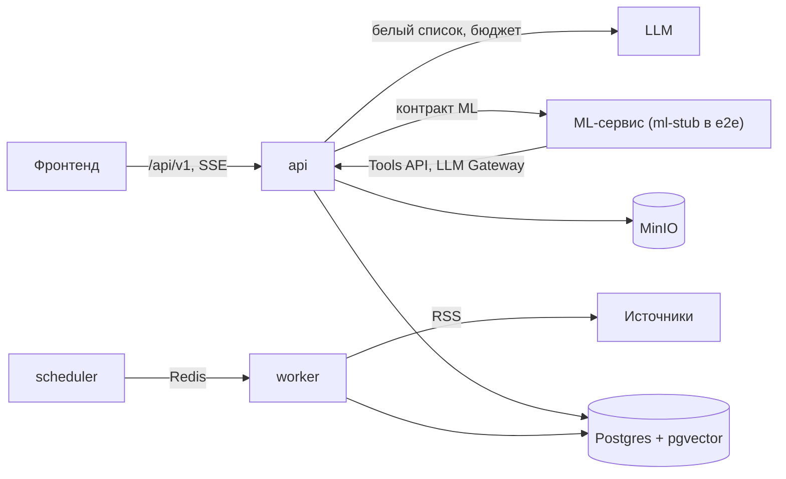

# Альфа-Будущее — персонализированные бизнес-инсайты для «Альфа-Бизнеса»

Сервис внутри интернет-банка «Альфа-Бизнес». Он превращает поток внешних новостей и аналитику Альфа-Банка в
персональные инсайты для руководителей среднего и крупного бизнеса:
- что произошло;
- почему это важно именно этой компании;
- риски, возможности и последствия;
- что можно сделать;
- как это оценивает банк;
- на чём основан каждый вывод.

Путь пользователя построен по CJM финансового директора — от значимого события до обоснованного решения.

Решение состоит из трёх частей: бэкенд (`backend/`), ML-сервис (`ml/`) и фронтенд (`frontend/`). Одна команда
поднимает все три. Без ключа LLM ML-сервис пишет инсайты на правилах (`rules@1`), поэтому весь сценарий проходит и
без внешних ключей; с ключом — агент с планированием, инструментами и самопроверкой. `ml-stub` — детерминированная
реализация того же контракта для e2e.

**Стенд:** https://dev.alpha.leksika1.ru (демо-учётки — ниже). Команда **AstraMax-CU**: стенд работает на ключе LLM
команды — просим активировать его на время проверки. Для локального запуска эксперт указывает свой ключ в `LLM_API_KEY`.

## Быстрый старт

Полное руководство по всему проекту: [`docs/PROJECT_GUIDE.md`](docs/PROJECT_GUIDE.md) — назначение,
пользовательские сценарии, архитектура трёх частей, данные, API, ML, запуск, проверки и эксплуатация.
Версия для передачи и чтения без репозитория: [PDF](docs/PROJECT_GUIDE.pdf).
Результаты проверки связки бэкенда с ML: [`docs/VERIFICATION.md`](docs/VERIFICATION.md).

Нужны Docker 24+ с Compose v2.24+, ≥ 4 ГБ памяти для Docker и ~5 ГБ диска.

```bash
cp .env.example .env
docker compose up -d --build        # или: make up
```

Первая сборка образов — 5–10 минут; при первом старте бэкенд скачивает модель эмбеддингов (~0,5 ГБ, кэшируется в
томе). Дальше стенд поднимается примерно за минуту, первые инсайты появляются через 30–60 секунд после старта.
На Windows, если `make` нет, команды из `Makefile` запускаются как есть.

**LLM.** В `.env` достаточно `LLM_API_KEY` (ключ команды): адрес шлюза организаторов
`https://api.alfahack-gateway26.ru/v1` и ID всех 6 моделей заданы по умолчанию. Если провайдер недоступен из сети
сервера — `LLM_PROXY_URL`. Расход и ошибки — `GET /api/v1/admin/llm-usage`, остаток лимита у провайдера —
`GET /api/v1/admin/llm-provider`. Тарифы моделей — ориентировочные тарифы организаторов, день бюджета начинается
в 03:00 МСК, как у провайдера.

| Что | Где |
|---|---|
| Интерфейс «Альфа-Бизнес» с разделом «Аналитика» | http://localhost:3000 (сценарий — [`frontend/README.md`](frontend/README.md)) |
| Swagger | http://localhost:8000/docs |
| ML-сервис (health) | http://localhost:8200/health |
| Готовность | http://localhost:8000/ready |
| Консоль MinIO | http://localhost:9001 (`minioadmin` / `minioadmin`) |

Порты меняются в `.env`: `API_PORT`, `FRONTEND_PORT`, `ML_PORT`, `POSTGRES_PORT` и т.д. Деплой на сервер (Dokploy:
бэкенд, ML и фронтенд — отдельные сервисы, автодеплой из CI) — [`docs/RUNBOOK.md`](docs/RUNBOOK.md), «Деплой».

## Сценарий проверки для жюри

**Автоматически** — 14 шагов пути пользователя с выводом того, что он видит:

```bash
docker compose exec api python scripts/demo_check.py
```

**Вручную в Swagger** (http://localhost:8000/docs → `Authorize`, токен из `POST /api/v1/auth/login` с `demo` /
`demo12345`):

| № | Этап CJM | Запрос | Что увидеть |
|---|---|---|---|
| 1 | Заметить сервис | `GET /api/v1/feed/summary` | Виджет на главной: непрочитанные, срочные, главный инсайт и «почему это для вас» |
| 2 | Подтвердить контекст | `GET /api/v1/me`, `GET /api/v1/companies/U_700001/profile` | Компании и роли; что сервис знает о компании, источник каждого признака, полнота |
| 3 | Выбрать важное | `GET /api/v1/feed?company_id=U_700001` | Лента по релевантности; `priority_reasons` — почему выше; ленты компаний разных отраслей различаются |
| 4 | Понять последствия | `GET /api/v1/insights/{id}` | Что произошло → почему важно вам (со ссылками на признаки) → последствия и сценарии → что делать → позиция банка |
| 5 | Проверить основания | `GET /api/v1/insights/{id}/trace`, `POST …/source-click` | Факт, аналитика банка, вывод модели и гипотеза разделены; источники с датами; шаги агента; переход к новости или странице PDF |
| 6 | Уточнить сценарий | `POST /api/v1/insights/{id}/ask` | Ответ потоком (SSE) с источниками и ограничениями анализа |
| 7 | Выбрать действие | `POST …/actions` `{"type":"callback"}`, `GET /api/v1/me/requests` | Заявка в мок-CRM и её статус; «наблюдать» — `POST …/state` `{"action":"watch"}` |
| 8 | Оценить и вернуться | `POST …/feedback`, `GET /api/v1/notifications`, `GET /api/v1/digest?company_id=U_700001` | Что сервис сделал с отзывом; уведомления; дайджест |
| — | Своя новость | `POST /api/v1/news/submit` `{"company_id":"U_700001","url":"…"}` | Ссылка или текст проходят общий конвейер; инсайт — для своей компании; недоступный сайт — «Ресурс сейчас недоступен для просмотра» |
| — | Админ (`admin` / `admin12345`) | `POST /api/v1/admin/news`, `GET /api/v1/admin/metrics` | Новость проходит конвейер и приходит уведомлением; north star и метрики этапов CJM |
| — | Админ: источники | `POST /api/v1/admin/sources/discover` `{"query":"BBC"}`, `POST /api/v1/admin/sources` | Поиск издания по названию или ссылке, проверка ленты, добавление без деплоя |
| — | Админ: эксплуатация | `GET /api/v1/admin/generation`, `GET /api/v1/admin/alerts`, `POST /api/v1/admin/analytics` | Монитор генерации, активные проблемы, загрузка PDF аналитики |

Смена роли меняет вариант инсайта и порядок ленты: `PUT /api/v1/me/companies/U_700001/role` `{"role":"cfo"}`.
Дополнение профиля (`PATCH /companies/{id}/profile`, например `{"currencies":["CNY"]}`) меняет релевантность.

## Демо-учётки (только для демо)

| Логин | Пароль | Доступ |
|---|---|---|
| `demo` | `demo12345` | 3 компании: металлоторговля (CEO), продуктовая розница (CFO), грузоперевозки (собственник) |
| `demo2` | `demo12345` | агрохолдинг (CEO), девелопер (казначей) |
| `admin` | `admin12345` | администратор: метрики, расход LLM, источники, ручные новости, статусы заявок |

## Данные

- **По умолчанию — синтетика** (`backend/data/synthetic/`, в репозитории, детерминированная): компании, платежи,
  связи, демо-лента новостей, демо-PDF аналитики. Все синтетические материалы помечены «ДЕМО (синтетика)».
- **Данные организаторов** в репозиторий не входят. Положить в `data/raw/` и указать `DATA_DIR=data/raw` в `.env`
  (`docs/DATA.md`). Seed загрузит 85 тыс. компаний (~2 мин) и выберет демо-компании; PDF-сканы аналитики пройдут OCR.
- **Новости**: 41 реальный источник — RSS российских и зарубежных изданий, отраслевые рубрики и страницы новостей
  министерств (`docs/SOURCES.md`), опрос каждые 15 минут; недоступный источник пропускается. Админ добавляет и отключает источники без деплоя. Для офлайн-демо
  есть синтетическая лента; с реальными новостями она не смешивается.
- **Ставка и курсы ЦБ**: официальные данные Банка России раз в час — агенту (`get_market_data`) и виджету
  (`GET /api/v1/market`).
- **Аналитика банка**: на стенде — демо-PDF; PDF организаторов загружаются через `POST /api/v1/admin/analytics`
  или из `data/raw/analytics` (`make ingest-analytics`).

## Архитектура

Бэкенд: FastAPI (`api`), Taskiq (`worker`, `scheduler`), PostgreSQL 16 + pgvector, Redis, MinIO (S3), `ml-stub`.
ML-сервис (`ml`) и фронтенд (nginx, `frontend`) — свои compose-файлы в своих папках, корневой `docker-compose.yml`
подключает все три. Подробно — [`docs/ARCHITECTURE.md`](docs/ARCHITECTURE.md), решения —
[`docs/DECISIONS.md`](docs/DECISIONS.md) (ADR-001…046).



- **Компании:** CSV → очистка и отчёт качества → граф связей → контекст компании (признаки с источником, полнота).
- **Новости:** вежливый сбор → сырьё в S3 → теги (русский и английский), срочность, защита от prompt injection,
  фильтр законодательства РФ → дедупликация → события.
- **Аналитика банка:** PDF → текст или OCR → фрагменты со страницами → гибридный поиск (векторы + BM25).
- **Генерация:** матчинг события с компаниями → агент ML-сервиса через Tools API и LLM Gateway →
  валидатор → инсайт.
- **Доставка:** лента, виджет, уведомления (SSE), дайджест, вопросы (SSE), действия, метрики по CJM.
- **Эксплуатация:** монитор генерации, алерты в Telegram, метрики Prometheus, резервные копии, автодеплой из CI
  после зелёных тестов.

## Основные переменные окружения

Каждая описана в [`.env.example`](.env.example).

| Переменная | Зачем |
|---|---|
| `DATA_DIR` | `data/synthetic` (по умолчанию) или `data/raw` |
| `INSIGHT_GENERATOR`, `ML_SERVICE_URL` | `remote` (ML-сервис, по умолчанию) или `stub` (ml-stub) |
| `LLM_API_KEY`, `LLM_DAILY_BUDGET_RUB`, `LLM_CHAT_BUDGET_SHARE` | LLM организаторов только через Gateway; жёсткий дневной бюджет и доля на вопросы |
| `LLM_BASE_URL`, `LLM_MODEL_MAP`, `LLM_PROXY_URL` | только для замены значений по умолчанию; прокси — если провайдер недоступен из сети сервера |
| `EMBEDDING_PROVIDER`, `EMBEDDING_MODEL` | эмбеддинги аналитики: `local` (fastembed, модель выбрала ML-команда); офлайн — `fake` |
| `NEWS_LIVE_SOURCES_ENABLED`, `NEWS_FIXTURES_ENABLED` | реальные RSS и синтетическая демо-лента |
| `FEED_TOPIC_CAP` | сколько карточек одной макротемы (ставка, курс) показывать в ленте «Все» |
| `ALERTS_PROVIDER`, `TELEGRAM_BOT_TOKEN`, `TELEGRAM_CHAT_ID` | алерты в Telegram (по умолчанию — в лог) |
| `MARKET_DATA_ENABLED` | ставка и курсы ЦБ раз в час (офлайн — `false`) |
| `BACKUP_INTERVAL_H`, `BACKUP_KEEP` | резервные копии Postgres и S3 в том `backups` (24 ч, 7 копий; `0` — выкл.) |
| `JWT_SECRET`, `SERVICE_TOKEN`, `ML_SERVICE_TOKEN` | секреты; с `APP_ENV=prod` dev-значения запрещены |

## Тесты и проверки

| Команда | Что |
|---|---|
| `make check` | lint + типы + unit (396) + integration (84, testcontainers) |
| `make e2e` | весь стек в профиле `test`, все 12 сценариев SPEC §11.2 (23 теста) — `docs/TESTING.md` |
| `make smoke-live` | один реальный RSS и один реальный вызов LLM через Gateway (нужны ключи; вне CI) |

CI (GitHub Actions) на каждый push в `dev` и `main` запускает lint, типы, unit, integration и e2e бэкенда, тесты ML
и сборку фронтенда; после зелёных заданий деплоит в Dokploy (`dev` → dev, `main` → prod).

## Интеграция команд

- **ML:**
  - [`docs/INTEGRATION_ML.md`](docs/INTEGRATION_ML.md), контракты [`contracts/`](contracts/README.md);
  - ML-сервис (`INSIGHT_GENERATOR=remote`) — [`ml/README.md`](ml/README.md).
- **Фронтенд:**
  - [`docs/INTEGRATION_FRONTEND.md`](docs/INTEGRATION_FRONTEND.md) (экраны → эндпоинты, SSE);
  - [`docs/API.md`](docs/API.md), [`docs/openapi.json`](docs/openapi.json).

## Документация

| Документ | О чём |
|---|---|
| [`docs/SPEC.md`](docs/SPEC.md) | Спецификация и трассировка на критерии кейса (источник правды) |
| [`docs/ARCHITECTURE.md`](docs/ARCHITECTURE.md) · [`docs/API.md`](docs/API.md) · [`docs/DATA_MODEL.md`](docs/DATA_MODEL.md) | Архитектура, API, модель данных |
| [`docs/METRICS.md`](docs/METRICS.md) · [`docs/TESTING.md`](docs/TESTING.md) | Метрики по CJM; тесты и сценарии |
| [`docs/SECURITY.md`](docs/SECURITY.md) · [`docs/RUNBOOK.md`](docs/RUNBOOK.md) | Безопасность; эксплуатация и типовые ситуации |
| [`docs/DATA.md`](docs/DATA.md) · [`docs/SOURCES.md`](docs/SOURCES.md) · [`docs/IMPACT_SCALE.md`](docs/IMPACT_SCALE.md) | Данные, источники новостей, шкала влияния |
| [`docs/DECISIONS.md`](docs/DECISIONS.md) · [`docs/ROADMAP.md`](docs/ROADMAP.md) · [`docs/REPORT.md`](docs/REPORT.md) · [`CHANGELOG.md`](CHANGELOG.md) | Решения (ADR), развитие, отчёт о решении, изменения |
| [`THIRD_PARTY_NOTICES.md`](THIRD_PARTY_NOTICES.md) | Лицензии зависимостей и моделей |

Известные ограничения — [`docs/SPEC.md` §16](docs/SPEC.md).

Материалы носят информационный характер и не являются инвестиционной рекомендацией.
