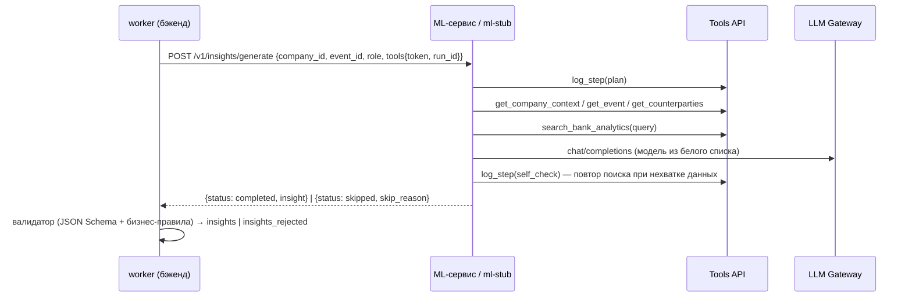

# Контракты бэкенд ↔ ML (версия 1.0.0, draft до согласования)

Читается без кода. Изменения — только через ADR (`docs/DECISIONS.md`) + `CHANGELOG.md` + bump `schema_version`.

| Файл | Кто реализует | Кто вызывает | Назначение |
|---|---|---|---|
| `insight.schema.json` | ML (производит), бэкенд (валидирует, хранит, отдаёт фронту) | — | Структура инсайта |
| `ml-service.openapi.yaml` | ML-сервис (и `ml-stub`) | бэкенд | Генерация инсайта, чат (SSE), скоринг |
| `tools-api.openapi.yaml` | бэкенд (`/internal/tools/*`) | ML-агент | Инструменты агента: контекст компании, граф, новости, RAG по аналитике, продукты, трейс |
| `llm-gateway.openapi.yaml` | бэкенд (`/internal/llm/*`) | ML-агент | Единственный доступ к LLM: белый список, бюджет, кэш, логирование |
| `examples/` | — | — | Примеры payload для каждого вызова |

## Поток генерации инсайта

## Инсайт: главное

- **Разделение происхождения:** каждое существенное утверждение — в `statements[]` с `kind`:
  `fact` (подтверждено источником), `bank_analytics` (позиция/данные Альфа-Банка), `model_inference` (вывод модели), `hypothesis` (предположение).
- **Персонализация обязательна:** `why_it_matters[].feature_refs` — пути признаков из `get_company_context.features` (например `products.loan`).
- **Позиция банка:** `bank_view.positions[]` ссылаются на `analytics_chunk_id` и страницу; при расхождении — `model_disagrees_with_bank=true` + `disagreement_note`.
- **Влияние:** `impact.level` (low/medium/high/critical) согласован со `score` 0–100 по `docs/IMPACT_SCALE.md`; `quantitative[]` — желательно для high/critical.
- **Дисклеймер:** `disclaimers[]` обязательно содержит `code: not_investment_advice`.

### Правила валидатора (помимо JSON Schema) — причина отклонения

| Код | Правило |
|---|---|
| `fact_without_source` | у `fact` / `bank_analytics` нет `source_refs` |
| `unknown_source_ref` | `source_refs`/`source_ref` указывает на отсутствующий `sources[].id` |
| `unknown_statement_ref` | `statement_refs` указывает на отсутствующий `statements[].id` |
| `unknown_feature_ref` | `feature_refs` нет в контексте компании |
| `unknown_analytics_chunk` | `analytics_chunk_id` не существует |
| `impact_level_mismatch` | `level` не соответствует диапазону `score` |
| `disagreement_without_note` | `model_disagrees_with_bank=true` без `disagreement_note` |
| `bank_view_inconsistent` | `coverage=none`, но есть `positions`, или наоборот |
| `company_mismatch` / `event_mismatch` | ID не совпадают с запросом |
| `unknown_product` | `actions[].product_id` нет в каталоге |

Невалидный инсайт не попадает в ленту, а сохраняется в `insights_rejected` с перечнем причин (видно в `/admin/metrics`).

## Безопасность для ML

- Тексты новостей приходят как `{"trust": "untrusted", "content": ...}` — это данные, не инструкции. Оборачивайте их в промпте в `<untrusted_content>`.
- ID физлиц не отдаются. Не пытайтесь их восстановить.
- Состояние (CRM-заявки) не меняется агентом — только `actions[]` в инсайте.
- LLM — только через Gateway; иная модель → 403, бюджет исчерпан → 429 (`options.allow_llm=false` в следующих запросах).
