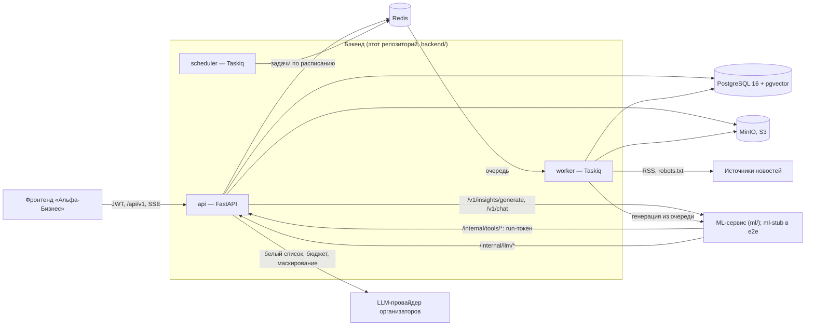
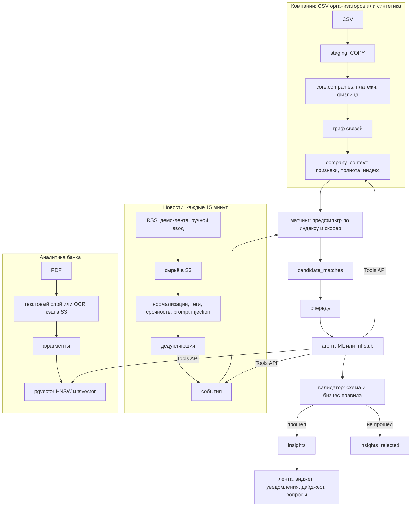
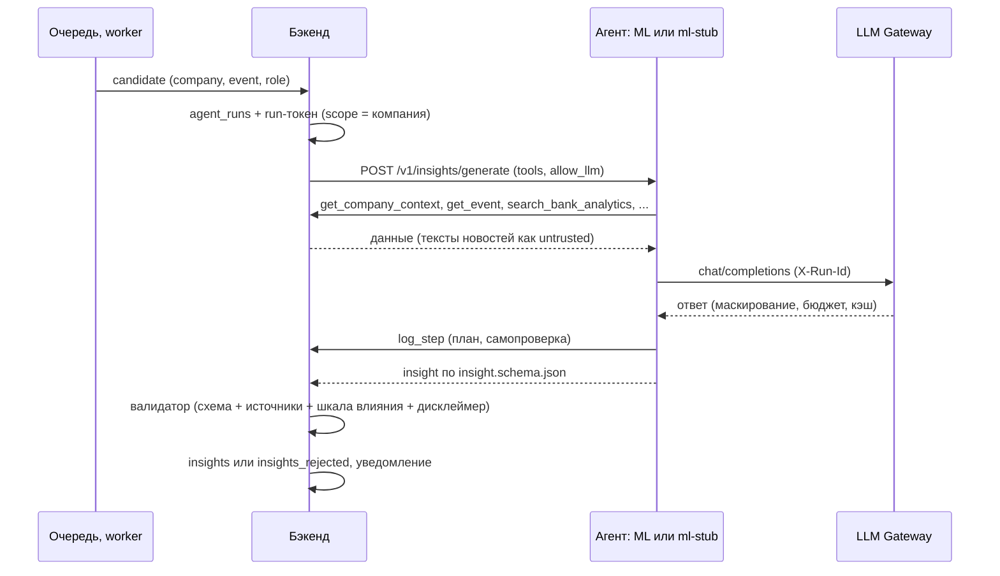

# Архитектура бэкенда «Альфа-Будущее»

Бэкенд превращает данные о компаниях, поток новостей и аналитику Альфа-Банка в персональные инсайты для ЛПР.
Он доставляет их во фронтенд «Альфа-Бизнес» и даёт ML-агенту инструменты и доступ к LLM. Логику агента — промпты,
выбор моделей и тексты инсайтов — делает ML-команда в сервисе `ml/` (подключён по умолчанию); бэкенд задаёт
контракты, проверяет результат и держит `ml-stub` — детерминированную замену агента для e2e (ADR-007, ADR-013).

## Компоненты

| Сервис (compose) | Роль |
|---|---|
| `api` | `/api/v1` (публичное API), `/internal/tools` (инструменты агента), `/internal/llm` (LLM Gateway), `/health`, `/ready`, `/metrics` |
| `worker` | генерация инсайтов из очереди, сбор новостей, загрузка аналитики, дайджесты, снимки метрик |
| `scheduler` | расписание: опрос новостей (15 мин), дайджесты (день, неделя), метрики (сутки), heartbeat |
| `postgres` | источник правды: компании, контекст, новости, события, инсайты, трассировка, расход LLM, уведомления; векторы и полнотекстовый индекс аналитики |
| `redis` | очередь задач Taskiq и результаты; rate limit (token bucket) |
| `minio` | сырые тела новостей, PDF аналитики, кэш OCR |
| `ml-stub` | детерминированная реализация ML-контракта: тот же поток вызовов, что у настоящего агента; e2e |
| `ml` (`ml/docker-compose.yml`) | ML-сервис команды ML: агент инсайтов, чат, ранжирование |
| `frontend` (`frontend/docker-compose.yml`) | nginx со статикой фронтенда; `/api` → `api` |
| `migrate`, `seed`, `minio-init` | одноразовые: миграции Alembic; справочники, демо-учётки, аналитика, предгенерация; бакеты S3 |

Код (`backend/app`):
- `api` — роутеры: `v1` публичный, `internal` для агента;
- `domain` — чистые правила без FastAPI и SQLAlchemy, mypy strict;
- `services` — сценарии;
- `integrations` — внешние системы: ML, LLM, эмбеддинги, OCR, PDF, новости;
- `repositories` — ORM-модели для миграций;
- `workers` — задачи Taskiq;
- `core` — конфигурация, безопасность, логи, ошибки, S3, rate limit.

## Потоки данных

1. **Компании** (ADR-015–017): CSV загружаются через `COPY` в `staging`, очищаются и проверяются (отчёт качества).
   Строится граф: платежи, общие физлица, гипотезы с уверенностью. Затем `company_context` — признаки с источником
   каждого (`csv` / `derived` / `user`), полнота и денормализованные колонки для матчинга. Недостающее — `NULL`
   и флаг полноты, данные не выдумываются.
2. **Новости** (ADR-020–022, 031): вежливый сбор (robots.txt, User-Agent, интервал, условные запросы). Сырьё
   хранится в S3, повторная обработка идёт без скачивания. Дальше тегер на правилах, срочность, флаг prompt
   injection, дедупликация и склейка в события. Здоровье источников отслеживается, при отказе опрашивается резерв.
   Ручной ввод новостей идёт тем же путём.
3. **Аналитика банка** (ADR-005, 023–027): PDF → текстовый слой или Tesseract OCR (кэш в S3) → нарезка по разделам
   со страницами → эмбеддинги (`EmbeddingProvider`, модель выбирает ML) и `tsvector`. Гибридный поиск RRF отдаёт
   цитату, страницу и ссылку на PDF (отдаёт API, ADR-033).
4. **Матчинг** (ADR-029): новое событие → один SQL-предфильтр по индексу (GIN) → скорер с разбивкой по компонентам
   → `candidate_matches`. Пересчёт идёт и при изменении профиля компании или роли пользователя.
5. **Генерация** (ADR-019): кандидат → `agent_runs` и run-токен → агент вызывает Tools API и Gateway → валидатор →
   `insights` или `insights_rejected`. Срочный инсайт создаёт уведомление.
6. **Доставка** (ADR-030): лента, виджет, дайджест, уведомления (SSE), вопросы к аналитике (SSE), действия
   (мок-CRM), отзывы. Всё пишется в лог событий для метрик CJM (`docs/METRICS.md`).

## Генерация инсайта

Вопрос пользователя (`POST /insights/{id}/ask`, `POST /ask`) устроен так же: это запуск агента `kind=chat`.
Бэкенд передаёт события агента потоком, а итоговый ответ отдаёт только после проверки `ChatFinal`.

## Хранение

- **PostgreSQL** (`core`, `staging`) — модель данных в `docs/DATA_MODEL.md`. Время хранится в UTC, деньги —
  `numeric(20,2)`, векторы — `vector(384)` с HNSW, полнотекстовый индекс — `tsvector('russian')` с GIN.
  Миграции Alembic; integration-тест проверяет, что схема не расходится с моделями.
- **S3** (`news-raw`, `analytics`, `snapshots`) — сырьё новостей по дате и sha256, PDF по sha256, кэш OCR.
- **Redis** — только очередь и rate limit; потеря Redis не теряет данных, а rate limit пропускает запросы.

## Безопасность

Подробно — в `docs/SECURITY.md`:
- JWT и доступ только к своим компаниям;
- run-токен агента ограничен одной компанией и одним запуском, Tools API только читает, каждый вызов в аудите;
- LLM только через Gateway: белый список, жёсткий бюджет, маскирование персональных данных;
- тексты новостей помечены как недоверенные;
- rate limit;
- в prod не стартует с dev-секретами.

## Масштабирование и сопровождение

- **API** не хранит состояние; `api` и `worker` масштабируются репликами. SSE-уведомления читают БД и не требуют
  sticky-сессий.
- **Матчинг** события по всей базе (≈42 тыс. клиентов) — 4,1 с в худшем случае при цели 5 с; кандидаты для всей базы включаются через
  `MATCH_SCOPE=all`.
- **Новый источник новостей** — строка в `news_sources.json`; новый вид источника — класс-коннектор (ADR-021).
- **Новый материал аналитики** — PDF в `data/raw/analytics` и `make ingest-analytics`; правил под конкретные
  файлы нет.
- **ML** — сервис `ml/` по контракту `contracts/ml-service.openapi.yaml` (`INSIGHT_GENERATOR=remote`, `ML_SERVICE_URL`).
  Эмбеддинги — `EMBEDDING_PROVIDER=local|remote` и `EMBEDDING_MODEL` (выбор ML-команды).
- **Развёртывание** — каждая часть (бэкенд, ML, фронтенд) — свой compose и свой сервис Dokploy; связь через общую
  сеть по алиасам; автодеплой из CI после зелёных тестов (ADR-032, `docs/RUNBOOK.md`).
- **Наблюдаемость** — JSON-логи с `request_id`/`trace_id`, `/metrics` (Prometheus: HTTP, LLM, бюджет, сбор
  новостей и генерация),
  `/ready`, `/api/v1/admin/*`. Эксплуатация — в `docs/RUNBOOK.md`.
