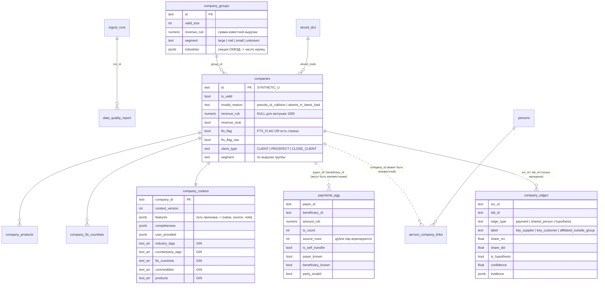

# Модель данных

Источник правды по схеме — ORM `app/repositories/models.py` + миграции `migrations/versions/`
(тест `tests/integration/test_schema.py` проверяет отсутствие расхождений). Здесь — смысл таблиц.
Документ дополняется по фазам (новости, аналитика, инсайты, пользователи — фазы 2–6).

## Схемы

| Схема | Назначение |
|---|---|
| `staging` | сырые строки CSV как `text` (цель `COPY`), с номером строки; перезаписываются при каждой загрузке |
| `core` | очищенные типизированные данные, граф, контекст, отчёт качества |

## ER-диаграмма (домен компаний, фаза 1)

## Таблицы

| Таблица | Ключ | Содержание |
|---|---|---|
| `core.ingest_runs` | `id` | прогон загрузки: вид, источник, статус, статистика и тайминги по шагам |
| `core.data_quality_report` | `id` | проверки качества прогона: `dataset`, `check_name`, `severity` (info/warn/error), `value`, `details` |
| `core.okved_dict` | `code` | все встретившиеся коды ОКВЭД → класс, группа, секция, отраслевые теги, сырьё, флаги чувствительности (из `data/reference/okved_*.csv`) |
| `core.companies` | `id` | юрлица (все типы клиентов); невалидные хранятся с `invalid_reason` |
| `core.company_groups` | `id` | агрегаты групп по валидным юрлицам |
| `core.company_products` | `(company_id, product)` | rko, guarantee, loan, leasing, deposit, payroll, factoring |
| `core.company_fts_countries` | `(company_id, country)` | нормализованный список стран ВЭД |
| `core.persons` | `id` | физлица (ID не уходят в LLM и API) |
| `core.person_company_links` | `(person_id, company_id)` | связи, включая компании вне базы (`company_known=false`) |
| `core.payments_agg` | `id`, uq `(payer_id, beneficiary_id)` | агрегированные платежи с флагами самоперевода и известности сторон |
| `core.company_edges` | `id`, uq `(src, dst, type, label)` | граф между **валидными** компаниями |
| `core.company_context` | `company_id` | материализованный профиль персонализации (только валидные компании) |

### Граф связей (ADR-015)

| `edge_type` / `label` | Направление | Вес и доли | Достоверность |
|---|---|---|---|
| `payment` | плательщик → получатель | `amount_rub`; `share_src` — доля в исходящих платежах плательщика, `share_dst` — во входящих получателя (знаменатель включает неизвестных контрагентов, без самопереводов) | факт |
| `shared_person` | `src_id < dst_id` | число общих физлиц | факт |
| `hypothesis` / `key_supplier` | плательщик → получатель | `share_src ≥ 10%` и получатель из секций A, B, C, D, G, H | гипотеза, `confidence = min(0.85, 0.35 + share)` |
| `hypothesis` / `key_customer` | плательщик → получатель | `share_dst ≥ 10%` | гипотеза |
| `hypothesis` / `affiliated_outside_group` | `src_id < dst_id` | общие физлица при разных `GROUP_ID` | гипотеза, 0.6 если есть платежи, иначе 0.4 |

Принадлежность к группе не материализуется попарно (группа из 624 юрлиц дала бы ~195 тыс. рёбер) —
используется `companies.group_id`; обход графа — recursive CTE по `company_edges`.

## Словарь признаков `company_context.features`

Каждый признак: `{"value": ..., "source": "csv|derived|user|external", "note"?: ...}`. Пути — словарь
`feature_refs` контракта инсайта и ответа `get_company_context` (Tools API).

| Группа | Пути |
|---|---|
| Идентичность | `okved.code`, `okved.name`, `okved.section`, `okved.section_name`, `industry_tags`, `region`, `city`, `age_bucket`, `staff_bucket`, `eco_stage`, `ownership_form`, `foreign_ownership`, `owner_info_reliable`, `client_type` |
| Масштаб | `revenue_rub`, `group.id`, `group.size`, `group.revenue_rub`, `group.client_count`, `segment` |
| Продукты | `products.{rko,guarantee,loan,leasing,deposit,payroll,factoring}` |
| Чувствительности | `sensitivities.rate_sensitive`, `sensitivities.rate_sensitive_industry`, `sensitivities.fx_sensitive`, `sensitivities.commodity_exposure`, `sensitivities.import_dependent`, `sensitivities.export_oriented`, `sensitivities.consumer_demand_dependent` |
| ВЭД | `fts_countries` |
| Контрагенты (`in`/`out`) | `counterparties.n_{in,out}`, `counterparties.amount_{in,out}_rub`, `counterparties.hhi_{in,out}`, `counterparties.unknown_share_{in,out}`, `counterparties.top_{in,out}` (топ-10: id, доля, сумма, известность, ОКВЭД, теги, регион, та же группа), `counterparties.industry_share_{in,out}.<tag>`, `counterparties.self_transfer_rub` |
| Связи | `links.shared_person_companies` (ID компаний), `links.shared_person_count` |
| От пользователя | `user_provided.{suppliers,customers,raw_materials,currencies,credit_plans,notes}` |

`completeness`: `score` (доля известных ключевых полей), `missing`, `stubs` (например `revenue_rub`), `user_fields`.

Правила вывода чувствительностей:

- `rate_sensitive` = есть кредит, лизинг или факторинг, **или** пользователь указал планы по кредитам (`source=user`).
- `fx_sensitive` = ФТС-флаг или страны ВЭД, **или** пользователь указал валюту, отличную от RUB.
- `commodity_exposure` = сырьё по ОКВЭД ∪ сырьё, указанное пользователем.
- `import_dependent` = отрасль зависит от импорта **и** у компании есть ВЭД.

Денормализованные колонки (`industry_tags`, `counterparty_tags` — отрасли контрагентов с долей ≥ 5%,
`fts_countries`, `commodities`, `products`, флаги) с GIN-индексами — инвертированный индекс для матчинга
событий с компаниями (фаза 5).

## Новости и события (фазы 2–3)

| Таблица | Ключ | Содержание |
|---|---|---|
| `core.sources` | `id` | каталог источников: вид (`rss`, `fixture`), URL, приоритет, `fallback_for`, темы; здоровье — `health_status`, `consecutive_failures`, `last_error`, `last_latency_ms`, `etag`/`last_modified` |
| `core.news_raw` | `id` | один опрос источника: исход (`ok`, `not_modified`, `unchanged`, `http_error`, `network_error`, `robots_disallowed`, `parse_error`), статус, ключ тела в S3 и SHA-256, задержка, число записей, новых и дублей |
| `core.news_items` | `id`, uq `canonical_url` | нормализованная новость: заголовок, лид (без строк с prompt injection), текст, дата, хэш текста, теги тегера, флаги (`suspected_prompt_injection`), `raw_id` |
| `core.events` | `id`, uq `cluster_key` | событие (кластер новостей): тип, направление, срочность и её причины, объединённые теги (GIN), первое и последнее упоминание, число новостей |
| `core.event_news` | (`event_id`, `news_id`) | состав события |

## Аналитика банка (фаза 4, ADR-024)

| Таблица | Ключ | Содержание |
|---|---|---|
| `core.analytics_documents` | `id`, uq `sha256` | PDF-материал: имя файла, ключ в S3 (`analytics/<sha256>.pdf`), название, дата (`doc_date`), темы (`topics`, GIN), происхождение (`organizers`, `synthetic`, `upload`), число страниц, метод извлечения (`text_layer`, `ocr_tesseract`, `mixed`), средняя уверенность OCR, статус (`processing`, `ready`, `failed`) и ошибка, модель эмбеддингов |
| `core.analytics_pages` | (`document_id`, `page`) | текст страницы, метод и уверенность извлечения, число символов — повторная нарезка без OCR |
| `core.analytics_chunks` | `id` | фрагмент: страница, порядковый номер, раздел, текст; `tsv` — generated `to_tsvector('russian', section ‖ text)` (GIN); `embedding vector(384)` (HNSW, `vector_cosine_ops`) |

Удаление документа каскадно удаляет страницы и фрагменты. Кэш OCR в S3: `analytics/ocr/<sha256>/<page>.<метод>.json`.
