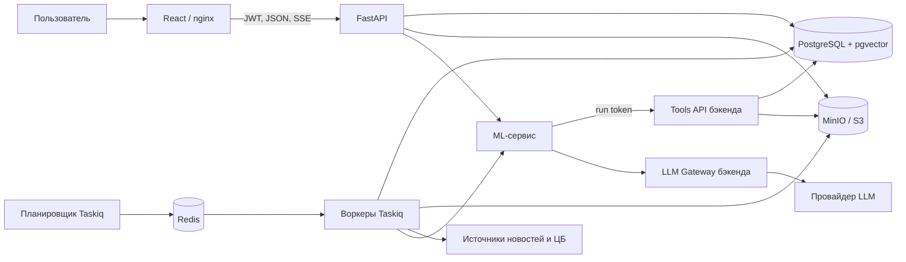

# Альфа-Будущее — документация всего проекта

Документ описывает поставляемый код на 26 октября 2026 года: веб-интерфейс, бэкенд, ML-сервис, данные,
контракты и эксплуатацию. Это самостоятельное руководство для знакомства с проектом, запуска и передачи
другой команде. Точные форматы запросов находятся в OpenAPI и JSON Schema; результаты отдельных экспериментов
содержатся в отчётах ML и не являются гарантией качества на произвольном потоке новостей.

## 1. Назначение и результат

«Альфа-Будущее» — прототип раздела персонализированной аналитики в интернет-банке «Альфа-Бизнес».
Он связывает внешние новости и аналитику банка с известными признаками компании: отраслью, продуктами банка,
внешней торговлей, сырьём, регионом, группой и платежными связями.

Результат — инсайт для конкретной компании и деловой роли пользователя. Карточка объясняет:

1. Что произошло.
2. Почему событие важно этой компании и какие признаки использованы.
3. Какие есть риски, возможности и сценарии.
4. Что можно сделать.
5. Что по теме говорит аналитика банка, если найден подходящий материал.
6. На каких источниках и допущениях основан вывод.

Материалы носят информационный характер и не являются инвестиционной рекомендацией. Заявки сохраняются
в мок-CRM проекта; интеграции с промышленной CRM и реальной системой интернет-банка здесь нет.

## 2. Пользователи и интерфейс

Фронтенд имитирует оболочку интернет-банка. После входа пользователь выбирает доступную компанию и роль:
`owner`, `ceo`, `cfo`, `chief_accountant`, `treasurer` или `other`. Роль влияет на порядок и вариант инсайтов.
Список доступных компаний задаётся на бэкенде, наличие идентификатора компании в запросе не даёт к ней доступ.

| Экран | Адрес в интерфейсе | Возможности |
|---|---|---|
| Вход | `/login` | Демо-учётки, вход по логину и паролю |
| Главная банка | `/` | Виджет аналитики, важные инсайты, непрочитанные и срочные |
| Лента | `/analytics` | Фильтры, период, риски/возможности, скрытые и отслеживаемые карточки |
| Инсайт | `/analytics/insight/:id` | Шесть смысловых блоков, источники, трасса, вопросы и действия |
| Вопрос аналитику | `/analytics/ask` | Ответ потоком с источниками и ограничениями |
| Профиль компании | `/analytics/profile` | Известные признаки, источники, полнота, анкета и связи |
| Материалы банка | `/analytics/materials` | Доступные PDF аналитики |
| Мои заявки | `/analytics/requests` | Заявки в мок-CRM и статусы |
| Администрирование | `/admin` | Метрики, LLM, источники, ручные новости, аналитика и генерация |

`/analytics/digest` перенаправляет в ленту; отдельная страница дайджеста не реализована. Дайджест доступен
через API, а в интерфейсе над лентой показаны счётчики за период.

### Сценарий демонстрации

1. Войти как `demo` и открыть виджет аналитики на главной.
2. Открыть ленту металлоторговой компании, затем переключиться на розницу или логистику и сравнить подборку.
3. В карточке изучить влияние, признаки персонализации и основания вывода.
4. Открыть новость или PDF на странице цитаты, затем трассу агента.
5. Задать вопрос в карточке; дождаться завершённого ответа с источниками.
6. Отправить заявку на звонок и проверить её в «Мои заявки».
7. Оценить полезность, скрыть или начать отслеживать инсайт.
8. Дополнить профиль компании и проверить пересчёт после фоновой обработки.

Демо-доступы предназначены для локального стенда и проверки прототипа:

| Логин | Пароль | Доступ |
|---|---|---|
| `demo` | `demo12345` | Металлоторговля, розница, грузоперевозки |
| `demo2` | `demo12345` | Агрохолдинг, девелопер |
| `admin` | `admin12345` | Администрирование |

На синтетике используются `U_700001`…`U_700005`. При загрузке данных организаторов seed подбирает компании
из фактически загруженной базы; идентификаторы синтетики для такого стенда не подходят.

## 3. Устройство репозитория

| Путь | Содержимое |
|---|---|
| `backend/` | FastAPI, доменная логика, интеграции, Taskiq, Alembic, скрипты и тесты |
| `backend/ml_stub/` | Детерминированная реализация ML-контракта для тестирования |
| `backend/data/reference/` | ОКВЭД, продукты банка, источники новостей, справочники |
| `backend/data/synthetic/` | Воспроизводимые демо-данные, новости и PDF |
| `ml/alfa_ml/` | Агент, чат, ранжирование, промпты, поставляемая модель ранкера |
| `ml/eval/`, `ml/reports/` | Разметка, оценка, эксперименты и отчёты ML |
| `frontend/src/` | React/TypeScript, страницы, компоненты, API-клиент и SSE |
| `contracts/` | Общие OpenAPI, схема инсайта и примеры |
| `docs/` | Спецификация, API, архитектура, данные, эксплуатация и решения |
| `data/raw/` | Локальные исходные данные организаторов, вне Git |
| `docker-compose.yml` | Общий локальный стек, включает compose трёх частей |
| `Makefile` | Команды запуска, загрузки данных и проверок |
| `.github/workflows/ci.yml` | Проверки и вызов вебхуков деплоя |

## 4. Архитектура и ответственность компонентов



| Компонент | Технология и назначение |
|---|---|
| `frontend` | React, TypeScript, Vite; nginx раздаёт сборку и проксирует `/api` |
| `api` | FastAPI: авторизация, компании, лента, инсайты, вопросы, администрирование, Tools API, Gateway |
| `worker` | Taskiq: загрузки, матчинг, генерация и фоновые операции |
| `scheduler` | Taskiq scheduler: новости, рыночные данные, дайджесты, метрики и алерты |
| `ml` | FastAPI: агент инсайтов, чат и необязательная перекалибровка кандидатов |
| `ml-stub` | Отдельный тестовый сервис с тем же интерфейсом |
| `postgres` | PostgreSQL 16 с pgvector: основное состояние приложения и индексы |
| `redis` | Брокер очереди и ограничение частоты запросов |
| `minio`, `minio-init` | Файлы, сырьё и создание бакетов |
| `migrate`, `seed` | Одноразовые миграции и начальная загрузка |
| `backup-db`, `backup-s3` | Дампы базы и копирование бакетов в том резервных копий |

Бэкенд разделён на `api` → `services` → `domain` / `integrations` / `repositories`; `core` содержит конфигурацию,
безопасность и клиентов инфраструктуры. Доменная логика не зависит от HTTP. Python-компоненты используют
Python 3.12 и отдельные `uv.lock`; фронтенд использует `package-lock.json`.

## 5. Данные и конвейеры

### Компании

CSV → загрузка через `COPY` в `staging` → очистка → таблицы `core` → граф → `company_context` → отчёт качества.
Контекст хранит не только значение, но и его происхождение (`csv`, `derived`, `user`, `external`) и полноту.
Отсутствующие данные остаются неизвестными. Самопереводы исключаются из анализа контрагентов; выручка-заглушка
не превращается в достоверную выручку. Неизвестным контрагентам не выдумываются профили.

Платёжная связь показывает поток денег. «Ключевой поставщик», «покупатель» и связь по общему физлицу
должны читаться вместе с типом, уверенностью и основаниями; платёж сам по себе не доказывает поставку товара.

### Новости

Каталог источников → RSS/Atom/RDF или HTML-коннектор → вежливый HTTP-сбор → сырьё в S3 → нормализация → теги,
срочность и флаги недоверенного содержимого → дедупликация → кластер события → матчинг → очередь генерации.
Повторная обработка сырья возможна без повторной загрузки страницы. Источники имеют состояние здоровья
и резервные ленты. Администратор может добавлять источники и отправлять новость через API.

Синтетическая лента и реальные новости разделены. Для двух карточек об одном событии важны кластеризация
и последующая очистка; лимит `FEED_TOPIC_CAP` дополнительно ограничивает повторение одной макротемы в «Все».
Наличие источника в каталоге не означает, что он доступен из любой сети.

### Аналитика банка и RAG

PDF → S3 по хэшу → текстовый слой, при его отсутствии Tesseract OCR → страницы → фрагменты → эмбеддинги
и полнотекстовый индекс → гибридный поиск RRF. Результат содержит текст цитаты, документ, страницу и UUID
фрагмента. Ссылка для скачивания выдаётся API; PDF можно открыть на странице цитаты.

Поддерживаются `fake`, `local` и `remote` эмбеддинги. Для смыслового поиска нужен рабочий провайдер;
при недоступности модели поиск может перейти на полнотекстовую часть. Синтетические векторы предназначены
для проверки конвейера, их нельзя использовать как оценку качества RAG. Размерность по умолчанию — 384;
смена размерности требует миграции и переиндексации, смена модели — переэмбеддинга.

Импорт ограничен размером PDF, количеством страниц и числом пикселей OCR. Пустой результат не публикуется.
Кэш OCR находится в S3; повторное индексирование и `--force` имеют разный смысл: первое меняет представление,
второе повторно обрабатывает документ.

### Рыночные данные

Бэкенд получает официальные ряды ЦБ: ключевую ставку и курсы USD/RUB, EUR/RUB, CNY/RUB. Они доступны через
`GET /api/v1/market` и инструмент `get_market_data`; обновляются по расписанию. При отключённом сборе
или отсутствии данных инструмент сообщает об отсутствии показателя, а не придумывает значение.

### Хранение

| Хранилище | Основные сущности |
|---|---|
| PostgreSQL `staging` | Сырые строки CSV для загрузки и проверки |
| PostgreSQL `core` | Компании, контекст, граф, новости, события, аналитика, инсайты, запуски, отзывы, заявки |
| pgvector / `tsvector` | Векторный и полнотекстовый поиск аналитики |
| S3 `news-raw` | Исходные ответы новостных источников |
| S3 `analytics` | PDF и результат обработки аналитики |
| S3 `snapshots` | Служебные снимки |
| Redis | Задачи очереди и rate limit |

Время в базе — UTC, деньги — `numeric(20,2)`, идентификаторы компаний — исходные строки `U_…`.

## 6. Как связаны бэкенд и ML

1. Бэкенд отбирает кандидата «компания × событие × роль» и создаёт `agent_runs`.
2. Выдаёт токен конкретного запуска с областью доступа одной компании.
3. Вызывает `POST /v1/insights/generate` у ML, передавая задачу, адреса Tools API/Gateway, токен и лимиты.
4. Агент собирает контекст, событие, новости, аналитику, группу, контрагентов и продукты через инструменты.
5. Агент строит план, черновик, выполняет самопроверку и при включённой LLM — проверку критиком.
6. Детерминированный сборщик ограничивает ссылки, признаки и цитаты доступными данными.
7. Бэкенд повторно валидирует результат и сохраняет инсайт либо причины отклонения.
8. Готовый инсайт доступен в ленте; срочное событие может создать уведомление.

Нерелевантная пара может завершиться `status: skipped`: это штатный результат. Невалидный ответ не публикуется.
Трасса включает шаги агента, аудит инструментов и сведения о вызовах LLM.

### Режимы генерации и ранжирования

| Настройка | Результат |
|---|---|
| `INSIGHT_GENERATOR=remote` | Настоящий сервис из `ml/` по `ML_SERVICE_URL` |
| `INSIGHT_GENERATOR=stub` | Детерминированный `ml-stub`, URL нужно указать соответствующий |
| `ML_LLM_ENABLED=false` | Настоящий ML-сервис пишет по правилам `rules@1` |
| Нет ключа, отказ или исчерпан бюджет LLM | Агент использует правила; причину проверяют в логах и трассе |
| `SCORER_PROVIDER=baseline` | Предварительный скоринг кандидатов правилами бэкенда |
| `SCORER_PROVIDER=remote` | Перекалибровка кандидатов через `/v1/score` ML-сервиса |

Remote-скоринг пересчитывает предварительный список: сначала baseline отбирает пары выше порога и
ограничивает их `MATCH_MAX_PER_COMPANY`, затем бэкенд отправляет их в ML батчами до 500, отдельно для
каждой роли. Недоступный или некорректный ответ возвращает конкретный батч к baseline. Если оценка
становится ниже порога, старая карточка этой компании и роли снимается. Текущий `/v1/score` выполняет
перекалибровку baseline; семантический `ml-ranker@2` используется отдельно внутри генератора.

Скорер бэкенда и скорер внутри агента — разные этапы. `SCORER_PROVIDER=baseline` не отключает внутренний
ML-отбор. `ml-ranker@2` использует правила, семантические признаки и память разметки. Веса эмбеддингов
ML-образ пытается включить при сборке; без них слой семантики отключается и используется `ml-ranker@1`.
Эта деградация не требует внешней LLM, но меняет качество отбора.

Каждая новая генерация имеет собственный `request_id`; HTTP-повторы внутри одного запуска сохраняют
его. Это позволяет запросить свежий результат при ручной перегенерации, сохранив идемпотентность
транспортных повторов. `ML_REQUEST_TIMEOUT_S` задаёт срок одной попытки, `ML_MAX_RETRIES` - число
повторов, run-токен покрывает все попытки. Для вопроса общий предел и срок токена задаёт `QA_TIMEOUT_S`.
Некорректные JSON/SSE от ML завершаются записанной ошибкой, которую можно увидеть в трассе и истории.

По умолчанию планировщик использует `gemma-4-26b-a4b`, аналитик и чат — `qwen3.6-35b-a3b`, критик —
`glm-5.3-flash`. Это алиасы Gateway; список разрешённых моделей можно получить через `/internal/llm/models`.
Один раунд исправления после критика задаётся `ML_MAX_ITERATIONS=1`; LLM-черновик используется при
релевантности не ниже `ML_LLM_MIN_SCORE=0.5`. Эти параметры относятся к агенту, а не к первичному
предфильтру кандидатов бэкенда.

### LLM Gateway

Все генеративные вызовы идут через `/internal/llm`, прямого ключа провайдера у агента нет. Gateway проверяет
модель по белому списку, маскирует чувствительные фрагменты, резервирует бюджет перед запросом, учитывает
расход и кэширует подходящие запросы. Дневной лимит по умолчанию — 450 ₽ и 3 млн токенов; вопросы могут
использовать не больше `LLM_CHAT_BUDGET_SHARE=0.3` дневного денежного бюджета. Начало дня — 03:00 МСК.

URL провайдера и соответствие алиасов идентификаторам организаторов уже заданы в коде. Для включения
достаточно `LLM_API_KEY` на бэкенде. `LLM_MODEL_MAP`, `LLM_PRICES` и `LLM_BASE_URL` нужны для переопределения.
Фактический расход зависит от ответа провайдера; оценочные тарифы и внутренний лимит не заменяют его баланс.
Запрос вне белого списка даёт 403, исчерпание бюджета — 429. Состояние видно в `/admin/llm-usage` и
`/admin/llm-provider`.

## 7. API и контракты

Публичный префикс — `/api/v1`. Авторизация: `Authorization: Bearer <access_token>`. Login выдаёт access и
refresh; access по умолчанию действует 30 минут, refresh — 7 дней. Ошибки используют RFC 7807
`application/problem+json`, в ответе и логах есть `trace_id`. Лента возвращает курсор `next_cursor`.

| Группа | Основные запросы |
|---|---|
| Авторизация | `POST /auth/login`, `POST /auth/refresh`, `GET /me` |
| Компании и роль | `GET /companies`, `GET/PATCH /companies/{id}/profile`, `GET /companies/{id}/graph`, `PUT /me/companies/{id}/role` |
| Лента | `GET /feed`, `GET /feed/summary`, `GET /digest` |
| Инсайт | `GET /insights/{id}`, `GET /insights/{id}/trace` |
| Реакции и действия | `POST /insights/{id}/state`, `/feedback`, `/source-click`, `/actions`; `GET /me/requests` |
| Вопросы | `POST /ask`, `POST /insights/{id}/ask` |
| Уведомления | `GET /notifications`, `GET /notifications/stream` |
| Материалы | `GET /analytics/documents`, `GET /analytics/documents/{id}/download`, `GET /news/{id}` |
| Дополнительно | `GET /market`, `GET /bank-products`, `POST /news/submit` |
| Администрирование | `/admin/metrics`, `/admin/generation`, `/admin/alerts`, `/admin/sources/*`, `/admin/analytics`, `/admin/llm-*` |
| Служебные | `/health`, `/ready`, `/metrics` без префикса `/api/v1` |

Точные тела, параметры и ответы: [API](API.md), [OpenAPI](openapi.json) и Swagger работающего API `/docs`.
Набор эндпоинтов таблицы сокращён; он не заменяет машиночитаемую спецификацию.

События чата передаются по SSE: `step`, `token`, `source`, `done`, `error`. Полученные токены ещё не означают
успешно проверенный ответ: клиент должен дождаться `done` или обработать `error`. Бэкенд валидирует финал
перед завершением и сохранением ответа. Уведомления переподключаются с `Last-Event-ID`.

| Контракт | Кто производит → кто потребляет |
|---|---|
| `contracts/insight.schema.json` | ML → валидатор бэкенда → фронтенд |
| `contracts/ml-service.openapi.yaml` | Бэкенд → ML: generate, chat, score |
| `contracts/tools-api.openapi.yaml` | ML → бэкенд: контекст, поиск, события, граф, трейс |
| `contracts/llm-gateway.openapi.yaml` | ML → бэкенд: модели, бюджет, chat/completions |
| `contracts/examples/` | Примеры для интеграции и тестов |

Схема инсайта требует типизации утверждений: `fact`, `bank_analytics`, `model_inference`, `hypothesis`.
Факты требуют источников, позиция банка — существующего фрагмента аналитики, персонализация — реальных
`feature_refs`, влияние — согласованной шкалы, результат — дисклеймера. Изменение общего контракта
сопровождается ADR, записью в `contracts/CHANGELOG.md`, версией схемы и обновлением примеров/моделей.

## 8. Запуск с нуля

Команды выполняются из корня клонированного репозитория. Для общего стека нужны Docker с Compose,
поддерживающим `include` (в проекте указана версия v2.24+), свободные порты и доступ к реестрам образов.
Для первой сборки и загрузки моделей требуется сеть. Время подготовки зависит от сети, CPU и наличия кэша.

```bash
cp .env.example .env
docker compose config -q
docker compose up -d --build
docker compose ps
curl -fsS http://localhost:8000/ready
```

Миграции и seed выполняются автоматически. Seed загружает справочники, компании при пустой базе, аналитику,
демо-пользователей и новости, затем ставит генерации в очередь. Готовность API не означает, что все фоновые
генерации завершены; их состояние видно администратору в `/admin/generation`.

| Ресурс | Локальный адрес |
|---|---|
| Веб-интерфейс | `http://localhost:3000` |
| API / Swagger | `http://localhost:8000/docs` |
| Готовность API | `http://localhost:8000/ready` |
| ML health | `http://localhost:8200/health` |
| MinIO console | `http://localhost:9001` |

При занятом порте измените соответствующий `*_PORT` в `.env`. Корневой compose объединяет части в локальную
сеть; для него в примере уже заданы `SHARED_NETWORK_EXTERNAL=false`, `BACKEND_ALIAS` и `ML_ALIAS`.

### Режим без внешней LLM

Оставьте `LLM_API_KEY` пустым или задайте `ML_LLM_ENABLED=false`. Настоящий ML-сервис продолжит работать
по правилам. Новости ЦБ/RSS и первая загрузка эмбеддингов при этом всё ещё могут обращаться в сеть.

Для воспроизводимого демо после подготовки Docker-образов укажите в `.env`:

```dotenv
INSIGHT_GENERATOR=stub
ML_SERVICE_URL=http://ml-stub:8100
EMBEDDING_PROVIDER=fake
NEWS_LIVE_SOURCES_ENABLED=false
NEWS_FIXTURES_ENABLED=true
MARKET_DATA_ENABLED=false
```

Затем выполните `docker compose up -d --build`. Такой режим проверяет сценарий и контракты на синтетике,
но не качество настоящей LLM и смыслового поиска. Для автоматизированного изолированного офлайн-сценария
предназначен `make e2e`.

### Подключение исходных данных

Положите CSV и папку `analytics/` в `data/raw/` по структуре [DATA.md](DATA.md), задайте
`DATA_DIR=data/raw`. На пустой базе данные загрузит seed. На существующей базе используйте команды:

```bash
make ingest-companies
make ingest-analytics
make ingest-news
```

`make ingest-news` также ставит новые генерации в очередь. Для повторного OCR: `docker compose exec api python
scripts/ingest.py analytics --force`; после смены модели эмбеддингов — та же команда с `--reembed`.
Ошибки отдельных PDF остаются в отчёте, загрузчик продолжает остальные файлы и возвращает ненулевой код
при частичном отказе. Данные организаторов и секреты не входят в репозиторий.

## 9. Конфигурация

Полный образец — [`.env.example`](../.env.example); значения Python по умолчанию —
`backend/app/core/config.py` и `ml/alfa_ml/config.py`, передача в контейнеры — compose-файлы частей.
При добавлении переменной важно проверить все три места: строка в `.env` сама по себе ещё не создаёт
переменную внутри контейнера. После изменения окружения пересоздайте соответствующий сервис.

| Группа | Основные переменные |
|---|---|
| Сеть и порты | `SHARED_NETWORK`, `SHARED_NETWORK_EXTERNAL`, `BACKEND_ALIAS`, `ML_ALIAS`, `API_PORT`, `FRONTEND_PORT`, `ML_PORT` |
| Секреты | `JWT_SECRET`, `SERVICE_TOKEN`, `ML_SERVICE_TOKEN`, `POSTGRES_PASSWORD`, `MINIO_ROOT_PASSWORD` |
| ML-связь | `INSIGHT_GENERATOR`, `ML_SERVICE_URL`, `INTERNAL_API_URL`, `SCORER_PROVIDER`, `ML_REQUEST_TIMEOUT_S`, `ML_MAX_RETRIES`, `QA_TIMEOUT_S` |
| Агент | `ML_LLM_ENABLED`, `ML_LLM_PLANNER`, `ML_LLM_CRITIC`, `ML_MODEL_*`, `ML_MAX_ITERATIONS`, `ML_LLM_MIN_SCORE` |
| LLM | `LLM_API_KEY`, `LLM_BASE_URL`, `LLM_MODEL_MAP`, `LLM_PRICES`, `LLM_PROXY_URL`, `LLM_DAILY_BUDGET_RUB`, `LLM_DAILY_TOKEN_LIMIT` |
| RAG и OCR | `EMBEDDING_PROVIDER`, `EMBEDDING_MODEL`, `EMBEDDING_DIM`, `EMBEDDING_REMOTE_*`, `OCR_PROVIDER`, `ANALYTICS_MAX_*` |
| Данные | `DATA_DIR`, `NEWS_LIVE_SOURCES_ENABLED`, `NEWS_FIXTURES_ENABLED`, `NEWS_POLL_INTERVAL_MIN`, `MARKET_DATA_ENABLED` |
| Выдача | `MATCH_SCOPE`, `FEED_TOPIC_CAP`, `LLM_CHAT_BUDGET_SHARE` |
| Эксплуатация | `APP_ENV`, `LOG_LEVEL`, `RATE_LIMIT_ENABLED`, `ALERTS_PROVIDER`, `TELEGRAM_*`, `BACKUP_INTERVAL_H`, `BACKUP_KEEP` |

У backend и ML должен совпадать `ML_SERVICE_TOKEN`. `INTERNAL_API_URL` — адрес бэкенда, доступный агенту,
а не адрес браузера. В контейнерах `localhost` указывает на сам контейнер. Настоящие секреты хранятся
в окружении/хранилище секретов; `.env` исключён из Git. `APP_ENV=prod` блокирует известные dev-значения
JWT и сервисных токенов, но не заменяет настройку всех учётных записей и доступов перед публичным запуском.

## 10. Разработка, проверки и CI

Для локальной разработки Python нужны 3.12 и `uv`, для фронтенда — Node 20+ и npm. API и ML имеют
раздельные окружения; инфраструктуру удобно оставить в Docker.

```bash
make install
make check
make e2e
make e2e-ml
```

`make check` проверяет только бэкенд: ruff, форматирование, mypy, unit и integration. Integration поднимает
Postgres/pgvector, Redis и MinIO через testcontainers, поэтому нужен работающий Docker.

```bash
cd ml
uv sync --frozen
uv run ruff check alfa_ml tests eval scripts
uv run ruff format --check alfa_ml tests eval scripts
uv run mypy
uv run pytest -q
```

```bash
cd frontend
npm ci
npm run build
npm run dev
```

Vite доступен на `http://localhost:5173`; `/api` проксируется на `API_PROXY_TARGET`, по умолчанию
`http://localhost:8000`. `npm run build` проверяет типы и собирает приложение. После изменения публичного API:
`make openapi`, затем `cd frontend && npm run gen:api`.

| Проверка | Что подтверждает | Что не подтверждает |
|---|---|---|
| Unit | Правила, схемы, валидаторы, обработку ответов и ошибок | Работу инфраструктуры |
| Integration | Сервисы на настоящих БД/S3/Redis, HTTP на контролируемых ответах | Доступность живых внешних систем |
| `make e2e` | Сквозные сценарии API с воркером, Gateway и `ml-stub` | Качество и работоспособность настоящего ML-образа |
| `make e2e-ml` | Связку бэкенда с настоящим ML по HTTP: очередь, Tools API, валидатор, ленту, чат, score и авторизацию | Качество платной LLM и семантической модели: здесь они отключены |
| ML tests | Агента/чат/ранкер на тестовых Tools API и Gateway, контракты | Качество живой LLM |
| Frontend build | Типы и сборку | Поведение всех экранов в браузере |
| `make smoke-live` | Реальный RSS и вызов LLM через Gateway | Полный пользовательский сценарий и доступность всех источников |

`make smoke-live` требует настроенного ключа и расходует внешний бюджет; в обычный CI не входит.
Офлайн-оценка ранжирования: `cd ml && uv run python -m eval.run_eval`; выводы и условия экспериментов
приведены в `ml/reports/`. Числа из разных наборов нельзя безоговорочно сравнивать между собой.

CI запускает `lint-type-unit`, `integration`, `e2e`, `ml`, `frontend`. На push в `dev`/`main` после зелёных
проверок задание `deploy` вызывает вебхуки трёх частей Dokploy. Наличие задания в YAML не подтверждает
успешный деплой: проверяйте результат CI и состояние сервисов отдельно.

## 11. Эксплуатация и диагностика

```bash
make ps
docker compose logs --tail=200 api worker ml
docker compose exec api python scripts/demo_check.py
make down
```

`make down` сохраняет тома. Команды удаления томов удаляют данные и не нужны для обычного обновления.
`demo_check.py` проходит сценарий пользователя через API и помогает проверить уже запущенный стенд.

| Симптом | Что проверить |
|---|---|
| Лента пуста | `/admin/generation`, завершение seed, логи worker, доступность ML |
| Генерации зависли/упали | `/admin/generation`, затем осмысленный retry через `/admin/generation/retry` |
| Растут отклонения | Причины в `/admin/metrics` и `insights_rejected`, трасса агента |
| Есть инсайты, но нет LLM | `models_used`, `llm_call`, `/admin/llm-usage`: ключ, бюджет, ошибки, порог LLM |
| Чат завершился ошибкой | Событие `error`, логи API/ML, таймаут и валидность финального ответа |
| Поиск по PDF слабый | Провайдер эмбеддингов, модель, `vector_rank`, переиндексация, качество OCR |
| Реальные новости не приходят | `/admin/sources/health`, сеть, robots.txt, состояние резервов |
| Данные ЦБ отсутствуют | `/market`, `MARKET_DATA_ENABLED`, `/admin/market/refresh` |
| 429 на API | Rate limit, частота запросов клиента; для Gateway — отдельно бюджет |
| Redis недоступен | Очередь и подключение Redis; сохранённые инсайты остаются в PostgreSQL |

Liveness — `/health`, зависимости — `/ready`, Prometheus — `/metrics`. Администратор видит качество данных,
метрики пути пользователя, источники, генерации, расход LLM и активные алерты. По умолчанию алерты пишутся
в лог; Telegram включается через `ALERTS_PROVIDER=telegram` и секреты бота/чата. Это эксплуатационные
сообщения, их адресатов настраивает владелец стенда.

### Развёртывание на сервере

В Dokploy части разворачиваются отдельно: `backend/docker-compose.yml`, `ml/docker-compose.yml`,
`frontend/docker-compose.yml`. Корневой файл предназначен для локального общего стека. Части соединяются
через общую `dokploy-network`; для dev/prod нужны разные алиасы и секреты. Домен указывает на frontend,
который проксирует API, ML можно оставить без публичного домена. У backend и ML согласуются алиас и токен.
Пошаговые настройки окружений, вебхуков и порядок запуска — [RUNBOOK.md](RUNBOOK.md#деплой-dokploy).

### Резервные копии

`backup-db` сохраняет дампы PostgreSQL, `backup-s3` копирует бакеты в том `backups`. По умолчанию интервал
24 часа, сохраняется 7 дампов базы; `BACKUP_INTERVAL_H=0` отключает цикл. S3-копия является зеркалом,
а не набором версий на каждую дату. Том находится на том же сервере, поэтому архив нужно отдельно выносить
во внешнее хранилище. Инструкции восстановления — [RUNBOOK.md](RUNBOOK.md#резервные-копии).

## 12. Безопасность и ограничения

Доступ пользователей проверяется по компаниям, административные операции — по роли платформы.
Агент ограничен run-токеном, Tools API аудируется. Новости считаются недоверенным вводом; инструкции
из текста источника не должны управлять инструментами. Сборщик ограничивает адреса для защиты от SSRF.
Gateway маскирует чувствительные значения, применяет белый список и бюджет. Агент предлагает действия,
но CRM-заявку создаёт отдельный запрос пользователя.

Практические ограничения текущего решения:

- Это прототип интернет-банка и CRM; банковские операции не выполняются.
- Без подходящей аналитики «позиция банка» отсутствует; вывод модели не должен выдавать себя за неё.
- OCR ошибается на таблицах и графиках; `OCR_PROVIDER=vlm` пока не реализован, рабочий путь — Tesseract.
- Входные данные компаний неполны; вид связи по платежам известен не всегда.
- Доступность RSS, сайтов, моделей и LLM зависит от сети и внешних провайдеров.
- Ранжирование на живом потоке может ошибаться; метрики ML относятся к указанным в отчётах наборам.
- Идемпотентность и кэши ML имеют ограничения процесса/объёма; их нельзя считать распределённым хранилищем.
- SSE требует корректного проксирования без буферизации и обработки переподключений клиентом.
- Бюджет LLM ограничен; работа по правилам является штатной деградацией и должна быть видна в трассе.
- E2E с `ml-stub` и `e2e-ml` без внешних моделей не заменяют приёмку живой LLM и интерфейса в браузере.

## 13. Карта подробной документации

| Документ | Назначение |
|---|---|
| [SPEC.md](SPEC.md) | Требования, границы, критерии и сценарии |
| [ARCHITECTURE.md](ARCHITECTURE.md), [DATA_MODEL.md](DATA_MODEL.md) | Компоненты и схема хранения |
| [API.md](API.md), [openapi.json](openapi.json) | API для клиентов |
| [INTEGRATION_ML.md](INTEGRATION_ML.md), [контракты](../contracts/README.md) | Связка backend ↔ ML |
| [INTEGRATION_FRONTEND.md](INTEGRATION_FRONTEND.md), [frontend README](../frontend/README.md) | Экраны, API, SSE |
| [ml README](../ml/README.md), [архитектура ML](../ml/docs/ARCHITECTURE.md) | Агент, ранкер, модели и деградация |
| [DATA.md](DATA.md), [SOURCES.md](SOURCES.md) | Исходные данные, загрузка, источники |
| [IMPACT_SCALE.md](IMPACT_SCALE.md) | Шкала влияния |
| [TESTING.md](TESTING.md), [ML reports](../ml/reports/) | Проверки и результаты экспериментов |
| [RUNBOOK.md](RUNBOOK.md), [SECURITY.md](SECURITY.md), [METRICS.md](METRICS.md) | Эксплуатация, безопасность, измерения |
| [DECISIONS.md](DECISIONS.md), [ROADMAP.md](ROADMAP.md), [CHANGELOG](../CHANGELOG.md) | Решения, развитие и изменения |
| [THIRD_PARTY_NOTICES.md](../THIRD_PARTY_NOTICES.md), [ML notices](../ml/THIRD_PARTY_NOTICES.md) | Зависимости, модели и лицензии |
