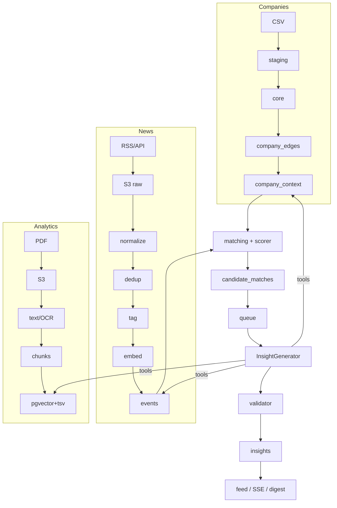

# SPEC — спецификация бэкенда «Альфа-Будущее»

Версия спеки: 1.0 (2026-10-22) · Единый источник правды для бэкенда. Изменения — через ADR (`docs/DECISIONS.md`).

Структура репозитория: `backend/` (этот документ; пути к коду — относительно `backend/`), `ml/`, `frontend/`, общие `contracts/` и `docs/` (ADR-018).

---

## 1. Цели и границы

### 1.1 Цель

Сервис внутри интернет-банка «Альфа-Бизнес», который превращает поток внешних новостей и аналитику Альфа-Банка в
**персонализированные инсайты** для ЛПР среднего и крупного бизнеса. Инсайт отвечает на 6 вопросов (кейс, стр. 14):
что произошло · почему важно именно этой компании · какие последствия (риски/возможности) · какие действия уместны ·
как оценивает банк · на чём основан вывод.

### 1.2 Что делает бэкенд (in scope)

1. Инфраструктура: docker-compose, PostgreSQL 16 + pgvector, MinIO (S3), Redis, воркеры, планировщик, миграции, сиды.
2. Данные о компаниях: загрузка, очистка, нормализация, граф связей, детерминированный контекст компании.
3. Сбор новостей: коннекторы, расписание, нормализация, дедуп, события, baseline-тегирование, срочность, резерв.
4. Аналитика банка: PDF → S3 → текст/OCR с номерами страниц → чанки → эмбеддинги + tsvector → гибридный поиск.
5. Инфраструктура ML-агента: Tools API, LLM Gateway, очередь генерации, трейсы, хранение и валидация инсайтов.
6. Baseline-отбор и ранжирование «событие × компания» (лента работает без ML).
7. Публичное API для фронтенда; 8. Безопасность; 9. Метрики; 10. Тесты, документация, артефакты сдачи.

### 1.3 Что НЕ делает бэкенд (out of scope)

- Фронтенд (только OpenAPI, CORS).
- ML-логика: промпты, планирование/самопроверка агента, обучение и выбор моделей, NER/классификация новостей уровня ML,
  итоговая генерация текста. Бэкенд предоставляет контракты (`contracts/`), `ml_stub` и интерфейсы с baseline-реализациями.

### 1.4 Допущения

- Полномочия пользователя в компании проверены интернет-банком (FAQ п.32) — эмулируются `user_company_access`.
- Основной сценарий — `CL_TYPE=CLIENT` (FAQ п.12, 57). PROSPECT/CLOSE_CLIENT хранятся, но доступа и инсайтов нет.
- Демо на 3–5 компаниях, архитектура — на всю выборку ~85 тыс. (FAQ п.69, 74).

---

## 2. Глоссарий

| Термин | Определение |
|---|---|
| Компания | юрлицо из `df_Uid_data_hack.csv` (`SYNTHETIC_U`) |
| Группа | `GROUP_ID`: объединение по владению/управлению (FAQ п.10) |
| Контрагент | компания, с которой есть платежи (без самопереводов); может быть «неизвестным» (нет в таблице юрлиц) |
| Новость | нормализованная статья из источника (`news_items`) |
| Событие | кластер новостей об одном факте (`events`); единица матчинга |
| Кандидат | пара событие × компания с baseline-скором (`candidate_matches`) |
| Инсайт | персонализированная интерпретация события для компании и роли по контракту `insight.schema.json` |
| Утверждение | атомарный тезис инсайта с `kind` ∈ {fact, bank_analytics, model_inference, hypothesis} |
| Запуск агента | `agent_runs`: генерация одного инсайта или ответа на вопрос, шаги — `agent_steps` |
| Роль | роль пользователя в компании: owner, ceo, cfo, chief_accountant, treasurer, other |

---

## 3. Трассировка требований

Статус: ☐ — запланировано, ◐ — частично, ☑ — готово и покрыто тестом. Обновляется по мере фаз (`/spec-sync`).

### 3.1 Критерии успеха (кейс, стр. 9–10)

| № | Критерий | Как закрываем | Где в коде | Тест | Статус |
|---|---|---|---|---|---|
| 01 | Определяет бизнес-контекст и отбирает значимые события с учётом признаков | `company_context` (отрасль, контрагенты с долями и отраслями, ВЭД, продукты → чувствительности, масштаб группы, регион) + rule-based матчинг и `RelevanceScorer` с breakdown | `app/domain/company_context.py` ☑, `app/services/company_context.py` ☑, `app/domain/scoring.py` ☑, `app/services/matching.py` ☑ (предфильтр по всей базе, ADR-029) | unit `test_scoring.py`; integration `test_api_flow.py` (надмножество предфильтра, `MATCH_SCOPE=all`); e2e №2 | ◐ |
| 02 | Содержательная интерпретация, несколько факторов, не пересказ | контракт требует `why_it_matters[].feature_refs`, `consequences`, `scenarios`; валидатор отклоняет инсайт без ссылок на признаки компании и без последствий | `contracts/insight.schema.json`, `app/domain/insight_validator.py` | unit `test_insight_validator.py` | ◐ |
| 03 | Аналитика банка в интерпретации; видно, что позиция банка, а что AI | `bank_view[]` со ссылками на `analytics_chunk_id` + страница; `statements[].kind`; `model_disagrees_with_bank` | `app/services/analytics_search.py` ☑, `app/services/analytics_ingest.py` ☑, `ml_stub/builder.py`, контракт | integration `test_analytics_pipeline.py`, `test_api_flow.py`; e2e `test_bank_analytics_indexed_and_cited` | ◐ |
| 04 | Отбор, объединение, суммаризация; связь с первоисточниками; минимум фактологических ошибок | дедуп + кластеризация в события; `sources[]`, `source_refs` у fact/bank_analytics обязательны; переход к первоисточнику (URL / presigned PDF#page) | `app/services/news_ingest.py`, `app/domain/clustering.py`, `app/domain/insight_validator.py`, `app/services/analytics_docs.py` | unit `test_clustering.py`; integration `test_news_pipeline.py`, `test_api_flow.py`; e2e `test_scenario_6_sources_news_and_pdf_page` | ◐ |
| 05 | Устойчивость на непоказанных новостях | общие коннекторы и тегирование по словарям, без привязки к сценариям; graceful degradation при пустых тегах | `app/integrations/news/`, `app/domain/tagging.py` | integration `test_api_flow.py` (ручная новость); e2e `test_scenario_12_unknown_news_passes_the_pipeline`, `test_scenario_11_prompt_injection_does_not_break_the_contract` | ☑ |
| 06 | Полный сценарий: вход → интерпретация → действие | auth → компании → лента → инсайт → CTA → мок-CRM | `app/api/v1/*` | e2e сценарии 1–10 (`test_flow.py`, `test_scenarios.py`) | ☑ |
| 07 | Масштабирование на новые отрасли, типы клиентов, источники; сопровождение | справочники как данные (`okved_dict`, `sources`), плагинные коннекторы, батчевый матчинг, горизонтальные воркеры, RUNBOOK | `data/reference/`, `app/integrations/news/registry.py` | unit `test_news_connectors.py` (плагины, в т.ч. `manual`); integration `test_news_pipeline.py`, `test_api_flow.py` (матчинг по всей базе); e2e `test_scenario_11_source_down_switches_to_reserve` | ◐ |
| 08 | Метрики и процесс мониторинга качества с учётом фидбэка | `/admin/metrics`, `metrics_daily`, процесс в `docs/METRICS.md`, золотой набор | `app/services/metrics.py` ☑, `app/api/v1/admin.py` ☑, `docs/METRICS.md` (метрики по CJM) | integration `test_api_flow.py`; e2e `test_scenario_5_feedback_is_visible_in_admin_metrics` | ◐ |
| 09 | Постоянная точка входа на главном экране | `GET /feed/summary` (непрочитанные, срочные, топ-1) + SSE | `app/api/v1/feed.py` ☑, `app/api/v1/notifications.py` ☑ (SSE, дайджест, ADR-030) | integration `test_api_flow.py`; e2e `test_notifications_stream_and_digest`, `test_scenario_9_urgent_news_reaches_the_user_over_sse` | ☑ |
| 10 | Взаимодействие с аналитикой: уточняющий вопрос, другой разрез, первоисточник | `POST /insights/{id}/ask`, `POST /ask` (SSE, с источниками), `GET /companies/{id}/graph`, фильтры ленты, presigned PDF (☑ `app/api/v1/analytics.py`) | `app/api/v1/qa.py` ☑, `app/services/qa.py` ☑ (проверка ответа, история) | integration `test_api_flow.py`; e2e `test_scenario_8_question_gets_sse_answer_with_sources` | ☑ |
| 11 | Агентная логика: план, инструменты, контекст, самопроверка | Tools API + `log_step` + `agent_runs/steps`; ML реализует логику; ml_stub — детерминированный аналог; ретраи/повторный поиск фиксируются как шаги | `app/api/internal/tools.py`, `app/api/internal/llm.py`, `ml_stub/` | integration `test_api_flow.py`, `test_llm_gateway.py`; e2e `test_agent_llm_calls_are_traced` | ◐ |
| 12 | Трассируемость: источники, признаки компании, промежуточные шаги | `GET /insights/{id}/trace`: feature_refs → значения признаков с `source`, `sources`, `agent_steps`, `tool_audit_log`, `llm_calls` (из `llm_usage`) | `app/services/feed.py` (`trace`) | integration `test_api_flow.py`; e2e №4, `test_agent_llm_calls_are_traced` | ☑ |

### 3.2 Ограничения (кейс, стр. 11–12)

| № | Ограничение | Как соблюдаем | Где | Тест | Статус |
|---|---|---|---|---|---|
| О1 | Не лента и не пересказ; глубокая интерпретация с учётом контекста | персонализация обязательна в контракте (`why_it_matters` с `feature_refs`); инсайт без связи с признаками компании отклоняется | валидатор | unit | ◐ |
| О2 | Аналитика банка — заметная часть ценности | `search_bank_analytics` в Tools API; `bank_view` в контракте; буст скоринга, если есть релевантная аналитика | `app/services/analytics_search.py`, `app/domain/scoring.py` | integration `test_analytics_pipeline.py`; e2e `test_bank_analytics_indexed_and_cited` | ◐ |
| О3 | Особенности конкретной компании, а не отраслевые тренды | признаки уровня компании: контрагенты, ВЭД-страны, продукты, группа, данные пользователя | `company_context` | e2e №2, `test_scenario_10_profile_update_changes_relevance` | ◐ |
| О4 | Только LLM из белого списка; бюджет ~500 ₽/день | LLM Gateway: allowlist (403), учёт токенов/₽, жёсткий стоп, кэш | `app/api/internal/llm.py` ☑, `app/services/llm_gateway.py` ☑ (ADR-028) | unit `test_llm_gateway_domain.py`; integration `test_llm_gateway.py` (в т.ч. бюджет под конкуренцией); e2e `test_scenario_11_llm_gateway_allowlist_and_budget` | ☑ |
| О5 | Неполные, неоднозначные, зашумлённые данные | staging → core с отчётом качества; NULL + `data_completeness`; «неизвестный контрагент»; OCR с оценкой уверенности | `app/services/ingest_companies.py` | unit `test_cleaning.py`, integration `test_ingest_companies.py` | ◐ |
| О6 | Безопасность AI: права, чувствительные данные, журналирование, ограничение действий | JWT + scoping компании; Tools API read-only в scope `run_id`; аудит инструментов и LLM; маскирование PII; rate limit; агент не выполняет CTA | `app/core/security.py`, `app/core/ratelimit.py`, `app/domain/llm.py` (маскирование), `docs/SECURITY.md` | integration `test_llm_gateway.py` (rate limit, маскирование); e2e №11: чужая компания, запрещённая модель, бюджет, prompt injection | ☑ |

### 3.3 Требования к сдаче (кейс, стр. 8)

| Требование | Где |
|---|---|
| GitHub + история + тег версии; доступ `alfa-hack-2026` | git, `CHANGELOG.md`, тег `v1.0.0` |
| README (назначение, архитектура, окружение, запуск, env, компоненты, сценарий проверки) | `README.md` |
| Docker + единый способ запуска | `docker-compose.yml`, `make up` |
| Lock-файлы | `uv.lock`, `.python-version` |
| THIRD_PARTY_NOTICES | `THIRD_PARTY_NOTICES.md` (`make notices`) |
| Синтетические данные и тестовые учётки | `data/synthetic/`, README «Демо-учётки» |
| Схема, API, OpenAPI, модель данных, тестовые сценарии | `docs/ARCHITECTURE.md`, `docs/openapi.json`, `docs/DATA_MODEL.md`, `docs/TESTING.md` |

---

## 4. Акторы и роли

| Актор | Платформенная роль | Доступ |
|---|---|---|
| ЛПР компании (физлицо) | `user` | свои компании из `user_company_access`; роль в компании — owner/ceo/cfo/chief_accountant/treasurer/other |
| Администратор сервиса | `admin` | admin-эндпоинты, метрики, ingest, перегенерация |
| ML-агент / ml_stub | `service` | Tools API в scope `run_id`, LLM Gateway |
| Планировщик/воркер | внутренний | БД, S3, очереди |

Персонализация по роли (`role_variant` в инсайте и веса скоринга):

| Роль | Фокус | Буст компонентов скоринга |
|---|---|---|
| owner / ceo | стратегия, рынок, контрагенты, регулирование | industry, counterparty, sanctions |
| cfo | стоимость денег, ликвидность, валюта | rate, fx, bank_analytics |
| treasurer | ликвидность, курсы, размещение | fx, rate, deposits |
| chief_accountant | налоги, отчётность, регулирование | regulation_tax |
| other | сбалансированно | — |

---

## 5. Функциональные требования

### 5.1 Данные компаний (FR-C)

- **FR-C1** Загрузка трёх CSV через `COPY` в `staging` (сырые строки + номер строки), затем валидация и перенос в `core`.
- **FR-C2** Очистка по правилам `docs/DATA.md`: заглушка выручки 1000 → NULL; коллизия `U_428697` → маркер `is_valid=false` (ADR-009);
  самопереводы → `is_self_transfer`; неизвестные контрагенты → `counterparty_known=false`; FTS-флаг = флаг ∨ есть страны; мусор в `RC_NAME` → NULL.
- **FR-C3** Отчёт качества `data_quality_report` (метрика, значение, порог, примеры) на каждый прогон ingest.
- **FR-C4** Справочник ОКВЭД: код → класс → секция (A–U) → отраслевые теги → флаги чувствительности (commodity, import, export, rate, consumer).
- **FR-C5** Группы: число юрлиц, суммарная валидная выручка, отрасли, сегмент (`large` если выручка группы > 15 млрд; иначе `mid`/`small` по порогам, источник `derived`).
- **FR-C6** Граф `company_edges`: `same_group`, `payment_out`, `payment_in` (вес — сумма, доля), `shared_person` (число общих физлиц),
  `hypothesis` (например, «вероятный поставщик» по направлению потока и отраслям) — с `confidence` и `evidence`.
- **FR-C7** `company_context` — материализованный профиль (§8.3), пересчитывается после ingest и после PATCH профиля пользователем.
- **FR-C8** Повторный ingest идемпотентен (upsert по ключам, новая версия отчёта качества).

### 5.2 Новости (FR-N)

- **FR-N1** Коннектор — плагин с общим интерфейсом (`fetch() → RawDocument[]`, `parse(raw) → NewsDraft[]`); добавление источника = запись в `sources` (+ парсер при необходимости).
- **FR-N2** Сырой ответ → S3 (`news-raw/{source}/{date}/{sha256}`), ссылка — `news_raw`. Повторная обработка из S3 без скачивания.
- **FR-N3** Нормализация: заголовок, лид, текст (очистка HTML), дата публикации (UTC), язык, канонический URL.
- **FR-N4** Дедуп: канонический URL → хэш нормализованного текста → near-duplicate по косинусу эмбеддинга (порог `NEWS_NEAR_DUP_THRESHOLD`).
- **FR-N5** Кластеризация в события: новые новости присоединяются к событию при сходстве ≥ порога в окне 72 ч, иначе создают новое.
- **FR-N6** Baseline-тегирование (ADR-007): ОКВЭД-секции/отраслевые теги, страны, регионы, сущности по словарям, тип события
  (monetary_policy, fx, commodities, sanctions, regulation_tax, trade_logistics, industry, company, macro_stat, labor, other), числа (ставка, %, курс).
- **FR-N7** Срочность по правилам: решение ЦБ по ставке, санкции/ограничения, ЧС, резкие движения курса/сырья, события по компаниям из графа.
- **FR-N8** Health-check источников (успех, латентность, новые статьи), статус `healthy/degraded/down`; при `down` основного — опрос резервного (`sources.fallback_for`).
- **FR-N9** Расписание: сбор каждые `NEWS_POLL_INTERVAL_MIN` (по умолчанию 15) мин; robots.txt, User-Agent, rate limit на домен.
- **FR-N12** Пользователь присылает ссылку или текст новости (`POST /news/submit`, ADR-038): обработка общим конвейером, инсайт — только для его компании; недоступный ресурс — статус `unavailable`.
- **FR-N13** По умолчанию — российские и зарубежные издания; английские новости тегируются теми же ключами; недоступный источник пропускается (ADR-039).
- **FR-N11** Источники настраивает админ (`/admin/sources`, ADR-036): проверка ленты, добавление RSS/Atom, включение и выключение, удаление своих; сборщик ходит только на публичные адреса.
- **FR-N14** Одно событие на решение Банка России (решение и комментарии в окне склейки), ставка — число решения, онлайн-трансляции не сохраняются (ADR-040).
- **FR-N10** Fixture-источник (`tests/fixtures/news/`, `data/synthetic/news/`) за флагом `NEWS_FIXTURES_ENABLED`.

### 5.3 Аналитика банка (FR-A)

- **FR-A1** Общий пайплайн для любых PDF: файл → S3 (`analytics/{sha256}.pdf`) → `analytics_documents` (тема, дата, теги, метод извлечения).
- **FR-A2** Извлечение по страницам: текстовый слой PyMuPDF; если символов < порога — OCR (`OcrProvider`, ADR-005), кэш OCR в S3.
- **FR-A3** Чанкинг: ~800 токенов с перекрытием, не через границы разделов; чанк хранит `doc_title`, `doc_date`, `page`, `section`, `text`.
- **FR-A4** Эмбеддинги → `vector(EMBEDDING_DIM)` (HNSW, cosine); `tsv` = `to_tsvector('russian', ...)` (GIN).
- **FR-A5** Гибридный поиск: вектор top-k + BM25 (`ts_rank_cd`) top-k → Reciprocal Rank Fusion; фильтры по дате/тегам; ответ с цитатой, страницей, ID чанка.
- **FR-A6** Ссылка на первоисточник: ссылка на PDF через API (токен на документ, 15 минут) + `#page=N` (ADR-033).
- **FR-A7** Загрузка PDF администратором (`POST /admin/analytics`): файл сразу виден со статусом `processing`, воркер прогоняет тот же пайплайн FR-A1…A4; повтор того же файла — без изменений, упавший — в очередь заново.

### 5.4 Матчинг, скоринг, генерация (FR-M)

- **FR-M1** Матчинг событий с компаниями батчами: инвертированный индекс по признакам (отраслевые теги, страны, флаги чувствительности, регионы, ID компаний в графе) → кандидаты.
- **FR-M2** `RelevanceScorer` (baseline): `score = Σ wᵢ·cᵢ · recency · source_quality · (1 − feedback_penalty)`, компоненты `cᵢ ∈ [0,1]`:
  `industry`, `counterparty`, `fx_country`, `rate`, `commodity`, `region`, `group`, `user_provided`, `bank_analytics`. Веса — по роли (§4), в конфиге.
  Результат: `score`, `breakdown{component: contribution}`, `matched_features[]`.
- **FR-M3** Порог отбора и лимит кандидатов на компанию в сутки (`MATCH_MIN_SCORE`, `MATCH_MAX_PER_COMPANY_DAY`).
- **FR-M4** Генерация: задача в очередь → `InsightGenerator` (`remote` = ML-сервис, `stub` = ml_stub) → валидация (§8.5) → `insights` или `insights_rejected`.
- **FR-M5** Идемпотентность по `request_id = hash(company_id, event_id, role, context_version)`.
- **FR-M6** Холодный старт: seed предгенерирует инсайты для демо-компаний.

### 5.5 Доставка и взаимодействие (FR-D)

- **FR-D1** Лента: персонализирована по пользователю, компании и роли; фильтры `all|urgent|risks|opportunities|saved`, период; сортировка — релевантность × свежесть; курсор.
- **FR-D2** Скрытые инсайты не показываются; открытые помечаются прочитанными.
- **FR-D3** `/feed/summary`: число непрочитанных, срочных, топ-1 заголовок — для виджета на главном экране.
- **FR-D4** Дайджест `day|week`: топ-N инсайтов периода + сводка по типам.
- **FR-D5** SSE-уведомления: новый инсайт с `urgent ∧ level ∈ {high, critical}`.
- **FR-D6** Вопросы к аналитике: `POST /insights/{id}/ask`, `POST /ask` → ML `/v1/chat` (SSE) с источниками; история в `qa_sessions/qa_messages`.
- **FR-D7** CTA: `contact_manager | callback | application` (+ `product_id`) → `crm_requests` (мок), статус.
- **FR-D8** Фидбэк: полезно/бесполезно + причина (`irrelevant | wrong | obvious | outdated | other`) + комментарий; влияет на `feedback_penalty`.
- **FR-D9** Дополнение профиля пользователем (анкета): ключевые поставщики/покупатели (отрасли, страны), сырьё, валюты, планы по кредитам/ВЭД → `company_context.user_provided` (source=`user`) → перерасчёт кандидатов и перегенерация.

### 5.6 Администрирование (FR-ADM)

`/admin/metrics`, `/admin/data-quality`, `/admin/sources/health`, `/admin/ingest/{news|analytics|companies}`, `/admin/insights/regenerate`, `/admin/llm-usage`, `/admin/analytics` (загрузка PDF и статусы обработки, FR-A7), `/admin/generation` и `/admin/generation/retry` (монитор генерации: очередь, зависшие запуски, повтор упавших), `/admin/alerts` и периодические алерты в Telegram или лог (ADR-034).

---

## 6. Нефункциональные требования

| ID | Требование | Целевое значение |
|---|---|---|
| NFR-1 | Латентность API (лента, инсайт) | p95 < 300 мс на демо-объёме |
| NFR-2 | Ingest всех CSV (~1,5 млн строк) | < 10 мин на ноутбуке (COPY) |
| NFR-3 | Матчинг одного события по всей базе | < 5 с (индексы по признакам) |
| NFR-4 | Время до первого полезного инсайта после входа | 0 с (предгенерация), новых — < 2 мин после события |
| NFR-5 | Наблюдаемость | JSON-логи, request_id/trace_id, `/metrics`, `/health`, `/ready` |
| NFR-6 | Воспроизводимость | `git clone → make up → сценарий`, lock-файлы, синтетика в репо |
| NFR-7 | Безопасность | §13, `docs/SECURITY.md` |
| NFR-8 | Бюджет LLM | ≤ `LLM_DAILY_BUDGET_RUB` (по умолчанию 450 из 500 ₽ — запас), жёсткий стоп |
| NFR-9 | Деградация | при недоступности ML → ml_stub/кэш; LLM-бюджет исчерпан → без LLM; источник down → резерв |

---

## 7. Архитектура (кратко)

Подробно — `docs/ARCHITECTURE.md`. Сервисы docker-compose:

| Сервис | Назначение |
|---|---|
| `api` | FastAPI: `/api/v1` (публичное), `/internal/tools` (агент), `/internal/llm` (Gateway), `/health`, `/ready`, `/metrics` |
| `worker` | Taskiq-воркер: генерация, сбор новостей, загрузка аналитики (OCR, эмбеддинги), дайджесты, снимки метрик |
| `scheduler` | Taskiq scheduler: сбор новостей, дайджесты, снимки метрик, heartbeat |
| `postgres` | PostgreSQL 16 + pgvector |
| `redis` | брокер очередей и результаты задач, rate limit (кэш LLM и уведомления — в Postgres, ADR-028/030) |
| `minio` / `minio-init` | S3 и создание бакетов |
| `ml-stub` | детерминированная реализация ML-контракта |
| `migrate` / `seed` | одноразовые: миграции; демо-данные, справочники, предгенерация |

Профили: `default` (всё для демо), `test` (e2e: синтетика, fixture-новости, ml_stub, fake-эмбеддинги/OCR/LLM, e2e-каталог источников).

```mermaid
flowchart LR
  FE[Фронтенд Альфа-Бизнес] -->|JWT /api/v1| API
  API --> PG[(Postgres + pgvector)]
  API --> R[(Redis)]
  API --> S3[(MinIO)]
  API -->|/v1/insights/generate, /v1/chat| ML[ML-сервис / ml-stub]
  ML -->|/internal/tools/* (service token + run_id)| API
  ML -->|/internal/llm/chat/completions| API
  API -->|allowlist + budget| LLM[LLM провайдер]
  SCH[scheduler] --> R
  R --> W[worker]
  W --> PG & S3
  W -->|RSS / API| SRC[Источники новостей]
```

---

## 8. Данные

Полная ER-модель — `docs/DATA_MODEL.md`. Схемы: `staging` (сырые CSV), `core` (основные таблицы).

### 8.1 Ключевые таблицы

| Домен | Таблицы |
|---|---|
| Компании | `companies`, `company_groups`, `okved_dict`, `company_fts_countries`, `company_products`, `persons`, `person_company_links`, `payments_agg`, `company_edges`, `company_context`, `data_quality_report` |
| Пользователи | `users`, `user_company_access`, `user_preferences` |
| Новости | `sources`, `source_health`, `news_raw`, `news_items`, `news_tags`, `events`, `event_news` |
| Аналитика | `analytics_documents`, `analytics_pages`, `analytics_chunks` |
| Инсайты | `candidate_matches`, `insights`, `insight_statements`, `insight_sources`, `insights_rejected` |
| Агент | `agent_runs`, `agent_steps`, `tool_audit_log`, `llm_usage`, `llm_cache` |
| Взаимодействие | `user_insight_state`, `feedback`, `user_actions`, `qa_sessions`, `qa_messages`, `notifications` |
| Банк | `bank_products`, `crm_requests` |
| Метрики | `metrics_daily` (+ вьюхи) |

### 8.2 Типы и соглашения

UTC `timestamptz`; деньги `numeric(20,2)`; ID компаний — `text` (`U_n`); прочие — `uuid`/`bigint`; полный инсайт — `jsonb` + ключевые колонки.

### 8.3 Признаки `company_context`

Каждый признак: `{value, source: csv|derived|user|external, as_of, confidence?}`.

| Группа | Признаки |
|---|---|
| Идентичность | okved_code, okved_section, industry_tags[], region, city, age_bucket, staff_bucket, eco_stage, ownership_form, foreign_ownership |
| Масштаб | revenue_rub (NULL для заглушки), group_id, group_size, group_revenue_rub, segment |
| Продукты банка | products[] (rko, guarantee, loan, leasing, deposit, payroll, factoring) |
| Чувствительности | rate_sensitive (loan ∨ leasing ∨ factoring ∨ user plans), fx_sensitive (FTS ∨ user currencies), commodity_exposure[] (ОКВЭД + сырьё от пользователя), import_dependent, consumer_demand_dependent |
| ВЭД | fts_countries[] |
| Контрагенты | top_in[], top_out[] (id, share, okved_section, known), unknown_share_in/out, hhi_in/out, counterparty_industries{tag: share}, n_counterparties |
| Связи | shared_person_companies[] (без ID физлиц), group_members_sample[] |
| Пользовательские | user_provided{suppliers, customers, raw_materials, currencies, credit_plans, notes} |
| Полнота | data_completeness{field: known/unknown/stub, score 0–1} |

### 8.4 Модель инсайта

Контракт — `contracts/insight.schema.json` (§12). Ключевые колонки `insights`: id, company_id, event_id, role_variant, title,
impact_level, impact_score, relevance_score, urgent, polarity (risk/opportunity/mixed), created_at, schema_version, trace_id, payload jsonb.

### 8.5 Валидатор инсайта

1. JSON Schema (`insight.schema.json`).
2. Бизнес-правила: у каждого `statement` есть `kind`; у `fact` и `bank_analytics` — ≥1 `source_ref`, существующий в `sources[]`;
   `bank_analytics` ссылается на `analytics_chunk_id`, существующий в БД; присутствует дисклеймер `not_investment_advice`;
   `why_it_matters` ≥1 элемент с непустыми `feature_refs`, существующими в контексте компании; `impact.level` соответствует диапазону `score`
   (`docs/IMPACT_SCALE.md`); `model_disagrees_with_bank=true` ⇒ есть `disagreement_note`; `company_id` совпадает с запуском.
3. Невалидный → `insights_rejected(reasons[])`, в ленту не попадает; метрика доли отклонённых.

---

## 9. Пайплайны

1. **Компании** (однократно + переиндексация): CSV → `staging` (COPY) → валидация → `core` → граф → `company_context` → отчёт качества.
2. **Новости** (каждые 15 мин): источники → raw в S3 → нормализация → дедуп → `news_items` → тегирование → эмбеддинг → события → срочность → матчинг.
3. **Аналитика** (по загрузке файла): PDF → S3 → страницы (текст/OCR) → чанки → эмбеддинги + tsvector → `analytics_chunks`.
4. **Матчинг**: новое/обновлённое событие или контекст → кандидаты → `RelevanceScorer` → `candidate_matches`.
5. **Генерация**: кандидат ≥ порога (для клиентов с активными пользователями) → очередь → `InsightGenerator` → валидатор → `insights` + `agent_runs/steps`.
6. **Доставка**: лента; срочные — SSE; дайджест — по расписанию и по запросу.



---

## 10. API

Полный перечень — `docs/API.md` и `docs/openapi.json`. Префикс `/api/v1`. Ошибки — RFC 7807. Пагинация — курсор.

| Группа | Эндпоинты |
|---|---|
| Auth | `POST /auth/login`, `POST /auth/refresh`, `GET /me`, `PUT /me/companies/{id}/role` |
| Компании | `GET /companies`, `GET /companies/{id}/profile`, `PATCH /companies/{id}/profile`, `GET /companies/{id}/graph` |
| Лента | `GET /feed`, `GET /feed/summary`, `GET /digest` |
| Инсайт | `GET /insights/{id}`, `GET /insights/{id}/trace`, `POST /insights/{id}/state`, `POST /insights/{id}/feedback`, `POST /insights/{id}/source-click`, `POST /insights/{id}/actions` |
| Вопросы | `POST /insights/{id}/ask` (SSE), `POST /ask` (SSE) |
| Уведомления | `GET /notifications/stream` (SSE), `GET /notifications` |
| Источники | `GET /analytics/documents`, `GET /analytics/documents/{id}/download`, `GET /news/{id}`, `GET /bank-products` |
| Admin | `GET /admin/metrics`, `GET /admin/data-quality`, `GET /admin/sources/health`, `POST /admin/ingest/{kind}`, `POST /admin/insights/regenerate`, `GET /admin/llm-usage` |
| Служебные | `GET /health`, `GET /ready`, `GET /metrics` |
| Внутренние | `/internal/tools/*` (`contracts/tools-api.openapi.yaml`), `/internal/llm/chat/completions` (`contracts/llm-gateway.openapi.yaml`) |

---

## 11. Сценарии

### 11.1 Пользовательские

1. Вход → виджет на главной (`/feed/summary`) → лента компании → инсайт → источник → действие.
2. Пользователь с несколькими компаниями переключает компанию и роль.
3. Пользователь дополняет профиль → лента перестраивается.
4. Пользователь задаёт уточняющий вопрос к инсайту и получает ответ с источниками.
5. Срочное событие → уведомление → инсайт.

### 11.2 E2E (`tests/e2e/`, `make e2e`)

1. Логин → список компаний → профиль с признаками и полнотой данных.
2. Лента не пуста, отсортирована по релевантности; у каждого инсайта дисклеймер, источники, statements с kind; **ленты двух компаний разных отраслей на одном наборе событий различаются**.
3. Смена роли CEO → CFO меняет вариант инсайта или порядок.
4. Инсайт → trace содержит признаки компании, источники, шаги агента.
5. Скрыть инсайт (пропадает), фидбэк «нерелевантно» сохраняется и виден в метриках.
6. Переход к источнику: новость и страница PDF через presigned URL.
7. CTA «обратный звонок» → запись в мок-CRM.
8. Вопрос к аналитике → SSE-ответ с источниками.
9. Новая срочная fixture-новость → пайплайн → SSE-уведомление → `/feed/summary` увеличился.
10. Дополнение профиля → перегенерация меняет релевантность.
11. Негативные: чужая компания → 403; запрещённая модель → 403; бюджет исчерпан → деградация; источник down → резерв; prompt injection в новости не ломает контракт.
12. Неизвестная новость (нет в сценариях) проходит пайплайн без падений.

---

## 12. Контракты с ML

`contracts/` (версия `schema_version` 1.0.0): `insight.schema.json`, `ml-service.openapi.yaml`, `tools-api.openapi.yaml`,
`llm-gateway.openapi.yaml`, `examples/`. Правила изменения — `contracts/README.md` (ADR + `contracts/CHANGELOG.md` + `schema_version`). Гайд для ML — `docs/INTEGRATION_ML.md`.

---

## 13. Безопасность

Подробно — `docs/SECURITY.md`.

- JWT; каждый запрос к данным компании проверяет `user_company_access`; роли `user/admin/service`.
- Tools API: сервисный токен + `X-Run-Id`; scope = компания запуска; только чтение; каждый вызов → `tool_audit_log`.
- Агент не выполняет действий, меняющих состояние (CRM-заявки) — только предлагает `actions[]`, выполняет пользователь.
- Prompt injection: тексты новостей передаются как данные в разметке `<untrusted_content>`, обрезаются, служебные последовательности экранируются; детектор подозрительных паттернов помечает новость (`news_items.flags`).
- Маскирование: ID физлиц, e-mail, телефоны не уходят в LLM и не пишутся в логи.
- Rate limit (Redis, token bucket) на публичные и внутренние эндпоинты; бюджет LLM.
- Секреты только через env; `.env.example` описывает каждую переменную.

---

## 14. Метрики

Подробно — `docs/METRICS.md`. Продуктовые: CTR ленты, доля раскрытых, hide rate, фидбэк +/− по причинам, переходы к источникам,
конверсия в CTA, время до первого полезного инсайта, доля вопросов, retention. Контент: доля отклонённых валидатором, доля утверждений
с источниками, покрытие компаний, свежесть, дубли. Технические: латентность, ошибки, здоровье источников, расход LLM, длительность пайплайнов.
Процесс: еженедельный разбор негативного фидбэка → корректировка правил/весов → регрессия на «золотом» наборе пар событие × компания.

---

## 15. Масштабирование и сопровождение

| Измерение | Подход |
|---|---|
| Вся выборка ~85 тыс. компаний | батчевый матчинг по инвертированному индексу признаков; генерация только для пар выше порога и для компаний с активными пользователями; горизонтальные воркеры |
| Новые отрасли | данные справочника `okved_dict` и словарей тегирования, не код |
| Новые источники | запись в `sources` + плагин-парсер при необходимости |
| Новые типы клиентов | `CL_TYPE` хранится; доступ/генерация включаются конфигом (`ELIGIBLE_CLIENT_TYPES`) |
| Новые материалы банка | тот же пайплайн PDF (текстовый слой или OCR) |
| Модели | эмбеддинги/скорер/генератор за интерфейсами; LLM — только через Gateway |
| Эксплуатация | `docs/RUNBOOK.md`: переиндексация, добавление источника, ротация ключей, бэкапы |

---

## 16. Известные ограничения

- Тип связи по платежам неизвестен (FAQ п.23) — только гипотезы с уверенностью.
- 42% плательщиков и 30% получателей (по строкам) — неизвестные контрагенты; их отрасль неизвестна.
- Аналитика банка — сканы: качество зависит от OCR; таблицы/графики распознаются частично.
- Доля рынка компании не вычисляется точно (нет рыночных данных) — допускается сравнение с выборкой (FAQ п.26) с явным указанием.
- Тексты инсайтов и ответов формирует ML-сервис (`ml/`, `INSIGHT_GENERATOR=remote`): с LLM — агент с
  планированием и самопроверкой, без LLM или при его недоступности — правила `rules@1`. Эмбеддинги аналитики —
  `paraphrase-multilingual-MiniLM-L12-v2` (выбор ML, ADR-ML-006).
- Фильтр законодательства РФ (ADR-037) — правила, а не юридическая экспертиза: возможны пропуски перефразировок;
  реестр сайтов сверяется с официальными реестрами вручную.
- Тарифы LLM неизвестны: бюджет считается по консервативной цене (ADR-028) и может срабатывать раньше.
- Метрика этапа CJM 04 («понял ли пользователь влияние») из логов не считается — опрос или экспертная разметка.
- Мок-CRM: статусы заявок меняет администратор; реальной интеграции с CRM банка нет (FAQ п.51).
