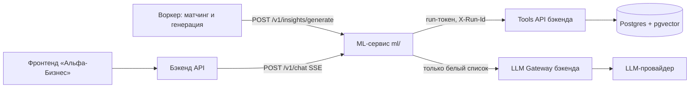
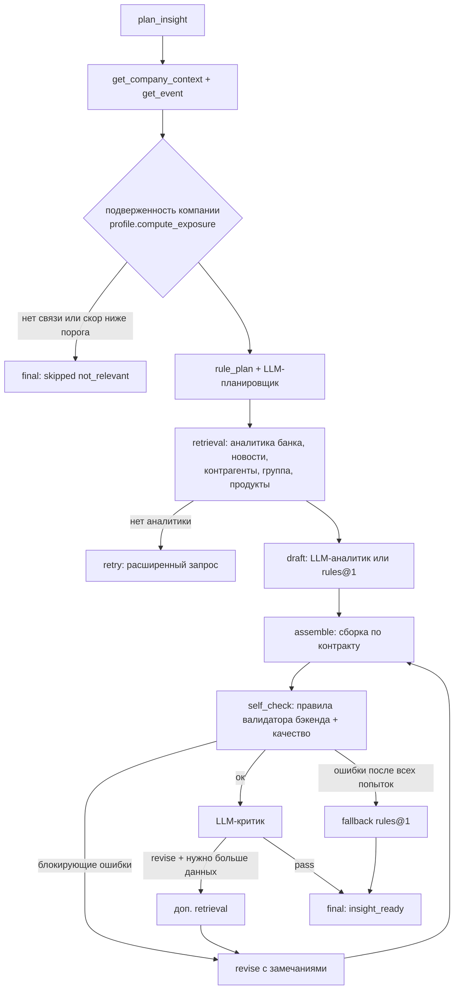

# Архитектура ML-сервиса

## Место в системе

ML-сервис не имеет своей базы и не видит данные других компаний: всё, что он знает, приходит через Tools API
с токеном, ограниченным одной компанией и одним запуском. Все LLM-вызовы — через Gateway бэкенда
(бюджет, кэш, маскирование PII, журнал `llm_usage`).

## Граф агента генерации (`alfa_ml/agent/runner.py`)

| Шаг | Что делает | Где |
|---|---|---|
| Подверженность | Для пары компания × событие считает факторы: `rate`, `fx_country`, `counterparty`, `commodity`, `industry`, `demand`, `user_provided`, `group`, `region`, `labor` — сила 0..1, пути признаков, объяснение | `profile.py` |
| Решение о показе | `ml-ranker@1` (noisy-OR × сила события × свежесть × роль); ниже `ML_SKIP_THRESHOLD` → `skipped` | `ranker.py` |
| План | Правила по типу события (какие запросы к аналитике, нужны ли контрагенты/группа) + LLM-планировщик добавляет запросы и гипотезы | `agent/plan.py`, `prompts/planner.md` |
| Сбор данных | Вызовы Tools API, каждый пишется в трассировку; недоступный инструмент деградирует анализ, а не запуск | `agent/runner.py`, `tools_client.py` |
| Черновик | LLM-аналитик (`prompts/analyst.md`) пишет JSON со ссылками на ID источников (`s1`, `sa1`, `sk`…) и пути признаков; без LLM — `agent/rules.py` | `agent/draft.py` |
| Слияние | Чего нет у LLM (причины, позиция банка, последствия) — берётся у rules@1; числа — только детерминированные | `Agent.merge_with_rules` |
| Сборка | ID утверждений, проверка ссылок, понижение атрибуции, сверка цитат банка, шкала влияния, релевантность, дисклеймеры, источники | `agent/assemble.py` |
| Самопроверка | Схема + бизнес-правила валидатора бэкенда (блокирующие) и качество: пересказ, персонализация, неиспользованная аналитика, атрибуция | `agent/checks.py` |
| Критик | Другая модель проверяет обоснованность, атрибуцию, персонализацию, глубину; может запросить доп. данные | `prompts/critic.md` |

## Чат (`alfa_ml/chat.py`)

Вопрос → контекст компании → аналитика банка по вопросу (+ заголовок события инсайта) → новости (для свободного
вопроса и «другого разреза») → группа (если спрашивают о юрлицах группы) → контрагенты (если спрашивают
о поставщиках/покупателях) → ответ LLM в JSON (`prompts/chat.md`) или детерминированный ответ → проверка
ссылок (факт без источника понижается) → SSE: `step`, `token`, `source`, `done`.

## Трассировка

Запуск = `run_id` бэкенда. Шаги через `log_step`: `plan` (входные данные, план, подверженность), `tool_call` /
`retrieval` (аргументы, превью ответа, задержка), `llm_call` (модель, версия промпта, токены, задержка, превью
JSON), `self_check` (блокирующие проблемы, замечания качества, исправления сборщика), `retry` (причина),
`final` / `error`. Бэкенд дополняет своими журналами `tool_audit_log` и `llm_usage` и показывает всё в
`GET /insights/{id}/trace`.

## Безопасность

- Тексты новостей и аналитики передаются в LLM только внутри `<untrusted_content>`; предложения-инструкции
  вырезаются до отправки (`strip_injection`); системные промпты запрещают исполнять инструкции из данных.
- Сервис только читает данные; действия (заявки) лишь предлагаются в `actions[]`.
- `product_id` — только из каталога, признаки — только существующие, позиция банка — только с фрагментом.
- Демо-материалы (синтетические PDF) всегда помечаются «не аналитика Альфа-Банка».
- Межсервисная авторизация: `ML_SERVICE_TOKEN`; к инструментам — run-токен из запроса.
